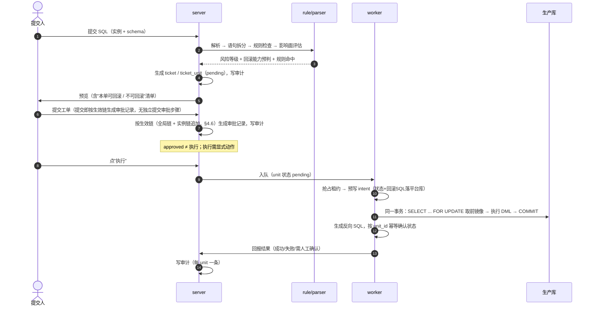

# SQL 审核平台

> 内部 SQL 变更的**唯一安全通道**——先审核、可回滚、全审计。

## 1. 背景（解决什么问题）

公司办公网与生产数据库网络隔离，开发/运维要改线上数据只能「找人开白名单 + 直接连库改」，带来的问题：

| 痛点 | 后果 |
|---|---|
| 没有审核 | 一条 `DELETE` 没写 `WHERE` 直接清库 |
| 没有回滚 | 出事只能靠 binlog 抢救 / 手工重建，慢且易错 |
| 没有审计 | 谁改了什么、改没改成功，事后对不上 |
| 无差别直连 | 生产账号权限过大，一个人就能删库 |

**本平台把「改生产」收口成一条强制流水线**：提交 SQL → 解析 → 规则审核（高危拦截）→ 生成回滚 SQL → 逐级审批 → 由 worker 在唯一通道执行 → 前镜像采集 → 全量审计落链。办公网唯一能触达生产库的出口就是本平台的 worker，查询、变更、审计天然 100% 闭环。

## 2. 使用技术

| 技术 | 用途 |
|---|---|
| Java 21 + Spring Boot 3.3.5 | 后端（Maven 多模块，12 个 `sqlaudit-*` 模块） |
| Druid | SQL 解析 AST（MySQL / PG 方言 visitor），规则审核与回滚 SQL 的基础 |
| Flyway | 数据库迁移（`V1__schema.sql` 只含 DDL + `V2__seed.sql` 只含 DML） |
| JWT + 数据化 RBAC | 鉴权：token 只带身份，角色 / 权限 / 实例范围全部在库中，界面可配 |
| Vue 3 + Vite + Element Plus | 前端（`npm run dev` / `npm run build`） |
| MySQL 8 / PostgreSQL 16 | 平台库两方言（两套 JDBC DAO + 两套迁移）；IoTDB 为被审核的目标库 |
| Docker | 本地起 MySQL / PostgreSQL / IoTDB 容器 |

## 3. 架构

### 3.1 分层图

```
                        ┌─────────────────────────────────────────────┐
  开发/运维 ──提交SQL──▶ │  sqlaudit-server（REST，办公网可访问）        │
                        │  parser → rule → rollback → workflow(审批)    │
                        └───────────────┬─────────────────────────────┘
                                        │ 队列（租约 + 心跳 + 预写 intent）
                                        ▼
                        ┌─────────────────────────────────────────────┐
                        │  sqlaudit-worker（唯一出口，防火墙只放行它）   │
                        │  executor → 生产库执行 + 前镜像采集             │
                        └───────────────┬─────────────────────────────┘
                                        ▼
                     MySQL / PostgreSQL / IoTDB（生产库，三类账号物理隔离）
                        ┌─────────────────────────────────────────────┐
                        │  audit（append-only + hash 链，全量留痕）      │
                        └─────────────────────────────────────────────┘
```

> **部署形态**：worker 已并入 server 单进程——mysql / postgres 方言 profile 下，执行循环随 server 自动启动（`WorkerLoopLifecycle`），生产无需单独部署 worker 进程；未激活任何方言 profile 时服务无法启动（没有默认方言，DataSource 直接报错）。

### 3.2 后端模块（Maven 多模块）

| 模块 | 职责 |
|---|---|
| `sqlaudit-common` | 公共模型、枚举（状态机 14 态、风险 4 级）、`SqlCipher` / `CredentialCrypto` 等加解密 |
| `sqlaudit-storage` | 存储层：DAO 接口 + MySQL / PostgreSQL 双方言 JDBC 实现（SQL 密文透明加解密） |
| `sqlaudit-parser` | SQL 解析（Druid AST，MySQL/PG 方言 visitor） |
| `sqlaudit-rule` | 审核规则（26 条内置 + 风险分级 + 全局/实例审批链路由） |
| `sqlaudit-rollback` | 回滚 SQL 生成（前镜像 + 反向 SQL + DDL 逆向） |
| `sqlaudit-executor` | 执行引擎（协议编排 + 执行前门禁） |
| `sqlaudit-query` | 查询通道（AST 白名单 + LIMIT 三层保护） |
| `sqlaudit-auth` | 账号与权限（数据化 RBAC + 三类生产账号物理隔离） |
| `sqlaudit-workflow` | 审批流 + 状态机（防自审、全局链 + 实例链追加） |
| `sqlaudit-audit` | 审计链（append-only + hash 链，单写入点） |
| `sqlaudit-server` | Web 入口（REST API + 提交编排） |
| `sqlaudit-worker` | 执行 worker（唯一生产库出口；已并入 server 单进程，mysql / postgres 方言 profile 下随 server 启动） |

### 3.3 目录结构

```
sql_audit/                            ← git 仓库根
├── README.md                         本文件（唯一权威文档）
├── sql-audit-ui-prototype.html       UI 原型
└── sql-audit/                        代码
    ├── backend/                      Maven 多模块（12 模块 + 父 pom）
    │   ├── sqlaudit-storage/         DAO 接口 + impl/jdbc/{mysql,postgresql}
    │   └── sqlaudit-server/          可启动 Web 入口（REST + 各 profile 装配）
    └── frontend/                     Vue 3 + Vite + Element Plus
```

## 4. 核心流程

### 4.1 变更流水线（提交 → 执行 → 回滚）

1. **提交预览**：粘贴 SQL，选单个目标实例，平台解析出语句清单、风险等级与可回滚清单；不可回滚的高危语句硬拒绝。
2. **规则审核**：26 条内置规则按风险分级（见 §4.3），命中硬底线直接评为 CRITICAL 并阻断。
3. **审批**：按「（全局 | 实例）× 风险等级」的生效链逐级审批（见 §4.6）。
4. **执行**：worker 抢占租约后在唯一通道执行；**执行前还有四道门禁**——并发互斥 / 结构漂移（DDL 指纹比对）/ 回滚能力复核 / 审批时效，任一不过绝不执行。
5. **回滚**：执行时采集前镜像并生成反向 SQL（见 §4.4），出事用「回滚管理」页逐条幂等回放。
6. **审计**：每一步操作写 append-only 审计链（hash 链防篡改），谁改了什么、改没改成功全程可追溯。

配套能力：**线上 SQL 查询**（办公网无法直连生产库，通过查询通道带 LIMIT 保护 + 动态脱敏 + 查询审计，查询页提供库/表浏览与语法高亮编辑器）。

### 4.2 工单生命周期（时序与状态机）

**时序**（一次变更工单从提交到执行）：



**关键点：前镜像采集与 DML 执行在同一个 JDBC Connection、同一个事务内。** 审核/审批阶段绝不提前生成回滚快照。

> 低峰执行窗口（`scheduled_at` 列）已删除，执行仅由**显式动作**触发（提交人点「执行」）。

**状态机**（枚举在 `sqlaudit-common`：`TicketStatus` / `UnitStatus` / `RollbackStatus`，非法迁移被 `canTransitionTo` 拒绝）：

**工单 ticket（14 态）：** `draft → submitted → auditing → (approved | rejected) → scheduled → executing → (succeeded | partially_succeeded | failed | needs_confirm) → closed`；任意态可 `cancelled`；`approved` 超时未执行 `expired`。

| 状态 | 可迁移到 | 说明 |
|---|---|---|
| draft | submitted / cancelled | 预览后提交，或放弃 |
| submitted | auditing / cancelled | 提交即按生效链生成审批记录（无独立「提交审批」步骤） |
| auditing | approved / rejected / cancelled | 组内 AND / OR 判定，SKIPPED 视为通过 |
| approved | scheduled / executing / expired / cancelled | 批准但尚未执行；超时（默认 24h）未执行 → expired |
| scheduled | executing / cancelled | 过渡态（低峰执行窗口已删除） |
| executing | succeeded / partially_succeeded / failed / needs_confirm | worker 幂等确认 |
| succeeded / partially_succeeded / failed | closed | partially_succeeded 按 unit 倒序回滚 |
| needs_confirm | succeeded / failed / closed | SQL 可能已在生产库生效但平台库状态未确认，**禁止自动重试**，人工核对 |
| closed / cancelled / expired | 终态 | expired 需重新审批（走新工单） |

**工单不是事务**：多语句工单没有原子性——unit#1 成功、unit#2 失败是正常结果，系统只保证「每个 unit 不执行两遍」；部分成功为 `partially_succeeded`，回滚按 `unit_order` 倒序且只回滚 `success` 的 unit。需要原子性的变更由提交人保证语句幂等可重入，或拆成互不依赖的工单。

**执行单元 ticket_unit（7 态）：** `pending → leased → executing → (success | failed | skipped)`；异常超时回收回 `pending`（仅在 `intent_written=0` 时）；`executing` 心跳停滞且未确认 → `needs_confirm`（人工核对）；`failed` 可「一键续跑」回 `pending`（只跑 failed / pending）。

| 状态 | 可迁移到 | 说明 |
|---|---|---|
| pending | leased | worker 抢占（硬条件 `intent_written=0`） |
| leased | pending / executing | 租约过期且未预写 → 回 pending（reaper） |
| executing | success / failed / needs_confirm | 心跳停滞超 TTL 且未确认 → needs_confirm，禁止自动重试 |
| failed | pending | 一键续跑 |
| needs_confirm | success / failed | 人工核对 |
| success / skipped | 终态 | — |

**队列幂等协议**：抢占租约 → 同一平台库事务内预写 `status=executing` + `intent_written=1` + 回滚 SQL 骨架（事务提交后才连生产库）→ 生产库单事务执行 → **条件 UPDATE 幂等确认**（`WHERE status='executing' AND executed_at IS NULL`，不加唯一约束，影响行数 0 即已确认）。

**回滚 rollback_sql（7 态）：** `generated → verified → applied | expired | not_available`（`verified` = 语法自检 + 影子库回放 / affected_rows 对账）；回放中断的结局态还有 `failed`（一条未应用）/ `partial`（部分应用，已应用的保留 applied 标记）。有效期默认 24h，过期自动 `expired`；执行回滚前按主键重查当前行并比对前镜像 hash，不一致 → **拒绝执行 + 告警**（数据已被后续工单改动）。

**执行前门禁**（审批通过到真正执行之间可能隔了几小时，执行前必须重新校验四件事，任一不过**不执行**）：

| 门禁 | 校验 | 不过时的动作 |
|---|---|---|
| 并发互斥 | 取 `exec_lock`（实例级锁，与租约同生命周期，reaper 一并回收） | 释放租约退回 pending，等下一轮 |
| 结构漂移 | 审核时记录 `ddl_fingerprint = SHA256(SHOW CREATE TABLE)`，执行前重算比对 | unit 置 failed，工单退回重审，告警 |
| 回滚能力复核 | 重新检查主键 / 触发器 / 外键 CASCADE 是否变化 | 回滚能力降级 → 阻断 |
| 审批时效 | `approved` 未超 `approval_ttl`（默认 24h） | 置 expired，需重新审批 |

### 4.3 SQL 审核引擎与规则

**三方言解析策略**：解析失败 = 高危 = 必须人工审核（`R_PARSE_FAILED`），绝不「降级放行」或假装解析成功。

| 方言 | 主方案 | 兜底 |
|---|---|---|
| MySQL 8.0 | Druid AST（MySQL visitor）→ 统一语句模型 | 解析失败 → 高危人工审 |
| PostgreSQL 14+ | Druid AST（PG visitor） | 同上 |
| IoTDB 1.x | 语句类型白名单（不做 AST） | 只开放受限写入白名单 |

**只读判定（查询免审的准入门槛）**：只用 AST 白名单，不用正则。任一命中即 **not readOnly** → 强制走审核工单：

- `EXPLAIN ANALYZE`（PG / MySQL 8.0.18+ 会**真实执行**语句）；
- `SELECT ... FOR UPDATE` / `FOR SHARE` / `LOCK IN SHARE MODE`（加行锁）；
- `SELECT ... INTO OUTFILE/DUMPFILE/@var`、PG `INTO new_table`、数据修改 CTE（`WITH ... DELETE/UPDATE/INSERT ... RETURNING`）；
- 存储函数 / 过程 / 触发器副作用、`SET` / `CALL` / `LOCK TABLES` 等会话副作用；
- 解析置信度不足（无法证明只读）。

只读白名单另要求：单语句、无子查询写副作用、带 `LIMIT`（平台自动补）。

**26 条内置规则（分组 + 严重度语义）**：`ERROR` 阻断提交，`WARN` 只提示；豁免必须走审批并写审计。四类硬底线规则 `nonOverridable`——破坏性 DDL、回滚不可用、解析失败、影响面超限——**任何配置都不能降级**。

| 分组 | 代表规则 | 级别 |
|---|---|---|
| 高危拦截（DML） | `R_NO_WHERE`（无 WHERE）、`R_NO_PK`（无主键，回滚能力）、`R_LIMIT_ORDER_DML`、`R_NONDETERMINISTIC_SET`（前镜像失效）、`R_MULTI_TABLE_DML` | ERROR，标不可回滚 |
| 影响面 | `R_AFFECT_TOO_MANY`（默认 10 万行阻断）、`R_PREIMAGE_TOO_LARGE`（前镜像超上限） | ERROR |
| 破坏性 DDL | `R_DDL_DESTRUCTIVE`（DROP / TRUNCATE / DROP COLUMN / MODIFY → 影子表流程） | ERROR |
| 对象与安全 | `R_OBJECT_NOT_ALLOWED`（实例白名单）、`R_SENSITIVE_COLUMN`（掩码列）、`R_SQL_INJECTION_PATTERN`、`R_PARSE_FAILED` | ERROR |
| IoTDB 专项 | `R_IOTDB_DROP`、`R_IOTDB_NO_TIME_RANGE`（DELETE 无时间范围） | ERROR |
| 查询通道 | `R_NO_LIMIT_QUERY`（平台自动补 LIMIT） | ERROR |
| 提示类 | `R_FULL_TABLE_SCAN`、`R_DDL_NO_IF_EXISTS`（不改写用户 SQL）、`R_SELECT_STAR`、`R_INDEX_NAME` / `R_TABLE_NAME`、`R_TX_DDL_MIX`、`R_BIG_UNIT_COUNT`、`R_LOW_PEAK_WINDOW`（建议低峰） | WARN |
| 执行期 | `R_SCHEMA_DRIFT`（执行前 DDL 指纹比对，提交期不触发） | ERROR |

完整清单与阈值在「系统配置 → 规则配置」页可见、可启停（nonOverridable 的 ERROR 不可降级）。

**风险分级 → 审批路由**（按命中规则与影响面定级；生效链 = 全局链 + 实例链追加，见 §4.6）：

| 等级 | 判定 | 默认审批链（V2 种子） |
|---|---|---|
| LOW | 低危变更（未命中高危规则） | 免审（空链直接通过） |
| MEDIUM | 常规 DML、影响行数 < 阈值 | 主管 1 人 |
| HIGH | 高危规则、大表变更、DDL | 主管 → DBA |
| CRITICAL | 破坏性 DDL、不可回滚、影响面超限 | 主管 → DBA → 管理员，且执行前二次确认（恒） |

### 4.4 回滚 SQL 生成与执行

**立场**：回滚 SQL 是事故处理手段，**可回滚是变更的准入门槛**——提交预览给出「本单可回滚 / 不可回滚」清单，不可回滚的高危语句按策略拒绝（默认 `R_ROLLBACK_UNAVAILABLE`）或强制兜底，绝不事后才发现「回滚不了」。

**覆盖率矩阵**：

| 语句 | MySQL | PostgreSQL | 手段 |
|---|---|---|---|
| `UPDATE ... WHERE` + 主键 + 确定性 SET | ✅ | ✅ | 前镜像 → 每行一条反向 UPDATE |
| `DELETE ... WHERE` | ✅ | ✅ | 前镜像 → 反向 INSERT |
| `INSERT` 单条（显式 / 自增主键） | ✅（LAST_INSERT_ID，仅单条自增） | ✅（RETURNING） | 反向 DELETE |
| 批量 INSERT / `INSERT...SELECT` / `ON DUPLICATE` / `REPLACE` | ❌ | ⚠️（RETURNING 多行可覆盖） | 标 `not_available` |
| 无主键表 DML | ❌ | ❌ | `R_NO_PK` 硬规则拒绝 |
| 函数 / 表达式 SET、触发器级联、外键 CASCADE | ❌ | ❌ | 标 `not_available` + 风险提示 |
| 可逆向 DDL（CREATE TABLE / ADD COLUMN / CREATE INDEX / RENAME） | ✅（带前置条件） | ✅ | 生成反向 DDL |
| 破坏性 DDL（DROP / TRUNCATE / DROP COLUMN / MODIFY） | ⚠️ | ⚠️ | RENAME 影子表 / 列投影备份，不生成反向 SQL |
| IoTDB 写入 / 删除 | n/a | n/a | 白名单 + 快照恢复 SOP，不生成 SQL |

**生成时机与事务边界**：审核 / 审批阶段**不采集前镜像、不生成回滚 SQL**（审批可能耗时数小时，快照必然失效）。执行时刻 worker 在**单连接单事务**内：`BEGIN → SELECT ... FOR UPDATE 取前镜像 → 执行 DML → 对账 → COMMIT → 用前镜像补全回滚 SQL → 按 unit_id 幂等落库`。

- **隔离级别**：PG 必须显式 `REPEATABLE READ`（默认 RC 下 `FOR UPDATE` 挡不住并发新插入，前镜像与 DML 行集会不一致）；MySQL 保持默认 RR（next-key lock），禁止连接串降级 RC。worker 连接池初始化时固定隔离级别，执行前 assert，不信任默认值。
- **affected_rows 对账（硬门禁）**：COMMIT 前比对 `affected_rows == 前镜像行数`，不等 → 回滚事务 + `needs_confirm` + 告警。MySQL 侧 `useAffectedRows` 必须保持默认 false（matched rows），否则值未变的行不计数、对账误报。
- **前镜像上限**：单 unit 5000 行 / 16MB（事务总时长超默认 5s 中止）；超限走主键分片（每片独立事务 + 独立前镜像 + 独立反向 SQL，回滚倒序逐片），分片仍超限 → `R_PREIMAGE_TOO_LARGE` 阻断。
- 前镜像列集合排除生成列（MySQL `VIRTUAL` / `STORED`、PG `GENERATED ALWAYS AS`）；回滚 SQL 的值**参数化存储**，展示时才拼字面量。

**MySQL DML 反向**：前镜像 → 每行一条反向 DML；`INSERT` 取同连接 `SELECT LAST_INSERT_ID()`（仅当前连接、仅单条自增有效，批量一律标 `not_available`——MySQL 无 `RETURNING`）。

**PostgreSQL DML 反向**：`DELETE ... RETURNING *` 一步拿到被删整行（反向 INSERT）、`INSERT ... RETURNING pk` 一步拿主键（反向 DELETE）；`UPDATE ... RETURNING` 返回的是**新值**，对回滚无用，前镜像照样先 `SELECT ... FOR UPDATE`。PG 的 DDL 是**事务性**的（MySQL 不是），DDL 工单可用「事务内执行 + 校验 + 显式 COMMIT」模式。

**DDL 逆向（禁用 CTAS）**：可逆向 DDL 生成反向 DDL，带有效期与前置条件（变更窗口内该表 / 列无新写入，有写入则拒绝生成、标 `not_available`）。整表级破坏性 DDL（DROP TABLE / TRUNCATE）走 **RENAME 影子表**（元数据级、秒级、完整保留结构与数据；执行前扫描外键 / 视图 / 触发器依赖，有引用则阻断）；**禁用 CTAS 做整表备份**（丢主键 / 索引 / 约束 / 自增）。列级（DROP COLUMN / MODIFY）走 online DDL + 列投影备份，MODIFY 改类型前先跑越界行数检查，有越界行阻断。

**IoTDB**：时间序列模型没有「行级反向操作」，**不承诺通用自动回滚**——只开放受限写入白名单（INSERT 带时间范围、受限 DELETE 强制时间范围）；DROP / TTL 变更强制人工审批 + 执行前元数据快照；恢复走快照导入 SOP，平台记录恢复入口 + 快照位置 + 操作人，不生成 SQL。

**回滚执行**：有效期默认 24h，过期自动 `expired`；执行前按主键重查当前行并比对前镜像 hash（依赖检测），不一致 → **拒绝执行 + 告警**（数据已被后续工单改动）；多 unit 部分成功按 `unit_order` **倒序**、只回滚 `success` 的 unit；回滚执行需**独立授权**（`rollback.execute` 权限点，与提交 / 审批分离）；执行复用队列幂等协议（§4.2），结果写审计。

### 4.5 RBAC 判定（数据化权限）

权限完全数据化，代码中没有角色码 / 权限码枚举与 `@RequirePermission` 注解：

- **模型**：`t_user ↔ t_user_role ↔ t_role ↔ t_role_permission ↔ t_permission ↔ t_permission_api`（权限点 ↔ 接口 1:N）；角色另挂 `instance_scope`（`ALL` / `SELECTED`）+ `t_role_instance` 定义实例数据范围。
- **鉴权**：拦截器取 Spring 选中处理器时的最佳匹配模式（`BEST_MATCHING_PATTERN`）+ HTTP 方法做**精确查表**，不匹配原始 URI（无 Spring Security 防火墙，规避分号 / `%2F` 类绕过）；公开端点仅 `POST /api/auth/login`。JWT 只带身份（userId），角色与用户状态**每请求从库读取**（短 TTL 缓存 + 写操作即时失效），停用 / 改权即时生效。
- **超管**：`SUPER_ADMIN` 只是「持有全部权限点 + 全部实例」的普通角色（种子），`admin` 账号绑定它；代码无任何超管特判。
- **防自锁**：撤角色 / 改角色权限 / 停用用户 / 删角色提交后，仍必须存在至少一个有效用户经任意角色持有元权限点（`rbac.manage`），否则整笔回滚返回 409。
- **实例数据范围**：任一授权角色 `instance_scope=ALL` → 全部实例；否则取这些角色 `t_role_instance` 的并集。生效入口：实例列表与库表元数据、工单预览 / 提交、线上查询、执行 / 回滚列表与明细、查看全部工单；越权 403。
- **前端**：`/api/auth/me` 返回用户可调用的接口集合（`"METHOD /pattern"`），菜单、路由守卫、按钮显隐一律按它判断；后端是唯一权威。

默认授权矩阵（V2 种子，5 个内置角色；`basic` 为 `all_users`，所有登录用户默认拥有，不写授权行）：

| 权限点 | 超级管理员 | 管理员 | DBA | 主管 | 开发 |
|---|---|---|---|---|---|
| ticket.submit 提交变更 | ✓ | ✓ | ✓ | ✓ | ✓ |
| ticket.view_all 查看全部工单 | ✓ | ✓ | ✓ | | |
| approval.confirm 执行前二次确认 | ✓ | ✓ | ✓ | | |
| execution.view 执行监控 | ✓ | ✓ | ✓ | | |
| rollback.view / rollback.execute 回滚 | ✓ | ✓ | ✓ | | |
| query.run 线上查询 | ✓ | ✓ | ✓ | ✓ | ✓ |
| audit.view 审计日志 | ✓ | ✓ | ✓ | | |
| rule.manage / flow.manage 规则与流程配置 | ✓ | ✓ | ✓ | | |
| instance.manage 实例与凭据 | ✓ | ✓ | | | |
| user.manage 用户管理 | ✓ | ✓ | | | |
| rbac.manage 角色与权限（meta 元权限） | ✓ | | | | |

### 4.6 审批流（追加模式）

- 流程 =（全局 | 某实例）× 风险等级，每个组合至多一条；**生效链 = 全局链节点组 + 实例链节点组**（追加，只会更严）。
- 节点类型：指定人（USER）/ 角色（ROLE）/ 实例负责人（INSTANCE_OWNER，提交时解析为具体用户并快照）；同 `node_order` 为一组，组内会签（AND）/ 或签（OR）。
- 节点解析到提交人本人时该记录 SKIPPED（跳过留痕，视为通过）；非 LOW 生效链为空 → 拒绝提交，不再自动批准。
- CRITICAL 一律执行前二次确认（接口权限控制，且不能是提交人）。
- 转交走选人：ROLE 节点由持有该角色者认领后转交，代理人须持有该角色；USER / INSTANCE_OWNER 节点可转给提交人以外的任一有效用户。
- 内置角色（种子）：超级管理员 / 管理员 / DBA / 主管 / 开发（默认授权矩阵见 §4.5）。

### 4.7 SQL 加密落库

- `t_ticket.sql_text`（工单原文）、`t_ticket_unit.statement`（执行语句）、`t_rollback_statement.reverse_sql / value_params`（反向语句与旧值参数，含前镜像生产数据）由存储层 AES-GCM 透明加解密（密钥 `SQLAUDIT_SQL_KEY`，见 §5.6），**库中无 SQL 明文**；`statement_hash` 按明文计算。应用层读写自动解密，业务代码不感知。
- 长度上限由应用层统一校验（单工单 SQL 文本 ≤ 1 MiB、单条查询 SQL ≤ 64 KiB，超限 400），两个方言行为一致。

## 5. 构建、启动、停止

### 5.1 环境要求

| 依赖 | 版本 | 说明 |
|---|---|---|
| JDK | 21 | 本机 SDKMAN 默认已切 21，直接 `mvn` 即可 |
| Maven | 3.x | 阿里云中央仓库镜像 |
| Node | 20+ | 前端（npm 走 npmmirror） |
| Docker | — | 跑 MySQL / PostgreSQL / IoTDB 容器 |

### 5.2 准备数据库

```bash
# 起数据库容器
docker run -d --name xiangxin-mysql \
  -e MYSQL_ROOT_PASSWORD=password -p 3306:3306 mysql:8.0
docker run -d --name sqlaudit-pg \
  -e POSTGRES_USER=postgres -e POSTGRES_PASSWORD=postgres -p 5432:5432 postgres:16-alpine
docker run -d --name iotdb -p 6667:6667 apache/iotdb:2.0.11-standalone   # 被审核的时序库实例，可选
```

**建库**（一次性；表结构由 Flyway 启动时自动迁移，无需手动跑 DDL）。库名 `sql-audit` 含连字符：

```bash
# MySQL（连字符库名要反引号）
mysql -h127.0.0.1 -uroot -ppassword -e \
  "CREATE DATABASE IF NOT EXISTS \`sql-audit\` DEFAULT CHARSET utf8mb4;"

# PostgreSQL（连字符库名要双引号；PG 的 Docker entrypoint 不支持连字符库名，需手动建）
docker exec sqlaudit-pg psql -U postgres -c 'CREATE DATABASE "sql-audit";'
```

**建表与种子**：Flyway 启动时自动执行 `db/migration/{mysql,postgresql}/` 下的 `V1__schema.sql`（只含 DDL，20 张 `t_` 前缀表）+ `V2__seed.sql`（只含 DML，两份文件逐字节相同）：审计链创世块；5 个内置角色（超级管理员 / 管理员 / DBA / 主管 / 开发）；13 个权限点与接口绑定；角色授权；`admin` / `dev` 账号（bcrypt）；26 条内置审核规则；4 条全局审批流（LOW 免审 / MEDIUM=主管 / HIGH=主管→DBA / CRITICAL=主管→DBA→管理员 + 二次确认）。`V3__table_remark.sql`（每方言一份，2026-11-24 起）追加第 21 张表 `t_table_remark`（平台侧表备注词典，展示时优先于原库原生注释）+ 表结构 / 备注三个新端点的接口绑定行。

> **旧库需 drop 重建**：两方言 yml 均为 `baseline-on-migrate: false`，指向「有表却没有 Flyway 迁移历史」的库会直接报错（不会静默 baseline 跳过）。本次重构（2026-11）迁移文件整体重写（V1–V7 收敛为两个文件），存量库重建：
>
> ```bash
> mysql -h127.0.0.1 -uroot -ppassword -e "DROP DATABASE IF EXISTS \`sql-audit\`; CREATE DATABASE \`sql-audit\` DEFAULT CHARSET utf8mb4;"
> ```
>
> 重建后正常启动即可，Flyway 自动执行 V1+V2。改表结构一律新增 `V3__xxx.sql`，**绝不改 `V1__schema.sql` / `V2__seed.sql`**（Flyway 迁移历史不可变）。

### 5.3 默认账号（V2 种子写入）

| 账号 | 密码 | 角色 | 用途 |
|---|---|---|---|
| `admin` | `admin12345` | SUPER_ADMIN + ADMIN + DBA + LEAD + DEV | 超级管理员（持有全部权限点 + 全部实例） |
| `dev` | `dev12345` | DEV | 开发（提交工单、查询通道） |

> 账号与角色由 `V2__seed.sql` 写入（bcrypt 口令散列预生成，代码里没有 `SeedUserRunner` / `SeedPermissionRunner`）。**生产环境务必改密码**。

### 5.4 启动后端

```bash
cd sql-audit/backend
mvn install -DskipTests   # 多模块依赖先进本地仓库，否则 spring-boot:run 拿旧 jar
SPRING_PROFILES_ACTIVE=dev-home mvn -pl sqlaudit-server spring-boot:run
# 端口 8888
```

**profile 组**（未激活任何方言 profile 时启动失败，无默认方言）：

| 组名 | 展开 | 场景 |
|---|---|---|
| `dev-home` | dev + mysql | **在家**：本机 Docker MySQL（127.0.0.1） |
| `dev-company` | dev + postgres | **公司开发**：PG，地址走 `SQLAUDIT_PG_URL` 注入 |
| `test` | test + postgres | **公司测试**：PG test 库，地址注入 |
| `prod` | prod + postgres | **公司生产**：PG prod 库，地址注入 + WARN 日志 |

> 也可手写组合：`SPRING_PROFILES_ACTIVE=dev,mysql` / `dev,postgres`。
> **无环境维度**：系统内没有 dev/test/prod 环境字段——开发 / 测试 / 生产靠上述组名各环境独立部署区分；实例、工单、审批流均无环境字段，顶栏无环境切换。

### 5.5 启动前端

```bash
cd sql-audit/frontend
npm install        # 首次
npm run dev        # 端口 5173，/api 代理到 8888
npm run build      # 生产构建（改前端后先跑一遍确认可通过）
```

浏览器打开 http://localhost:5173 。

### 5.6 环境变量

**连接类**（不同环境地址不同，靠它区分）：

| 方言 | 环境变量 | 默认值 |
|---|---|---|
| mysql | `SQLAUDIT_DB_URL` / `SQLAUDIT_DB_USER` / `SQLAUDIT_DB_PASSWORD` | `127.0.0.1:3306/sql-audit` / root / password |
| postgres | `SQLAUDIT_PG_URL` / `SQLAUDIT_PG_USER` / `SQLAUDIT_PG_PASSWORD` | `127.0.0.1:5432/sql-audit` / postgres / postgres |

**密钥类**（都有内置开发默认密钥，本地可直接跑；**生产必须注入**）：

| 环境变量 | 用途 | 说明 |
|---|---|---|
| `SQLAUDIT_JWT_SECRET` | 登录 JWT 签名（HS256） | 任意随机串；泄漏即可伪造任意身份 |
| `SQLAUDIT_CREDENTIAL_KEY` | 生产库凭据 AES-GCM 密钥 | base64 的 32 字节随机密钥（或任意串自动补齐） |
| `SQLAUDIT_DETAIL_KEY` | 审计明细 AES-GCM 密钥 | 同上；与凭据密钥隔离，轮换不破审计 hash 链 |
| `SQLAUDIT_SQL_KEY` | 工单 / 回滚 SQL 密文 AES-GCM 密钥 | 同上；工单原文、执行语句、反向语句在存储层透明加解密。**密钥丢失则历史工单与回滚 SQL 不可读**，与审计明细密钥同等对待、务必备份 |

公司各环境配不同地址：同一套代码 + 同一组名（如 `test`），只换环境变量指向不同库：

```bash
SPRING_PROFILES_ACTIVE=test \
  SQLAUDIT_PG_URL='jdbc:postgresql://pg-test.internal:5432/sql-audit' \
  SQLAUDIT_PG_USER=sqlaudit SQLAUDIT_PG_PASSWORD=*** \
  mvn -pl sqlaudit-server spring-boot:run
```

> 生产凭据严禁写进仓库，只走环境变量（或 CI/CD 的密钥系统注入）。

### 5.7 端到端准备（实例 + 凭据，UI 一次配置）

提交 → 审批 → worker 自动执行的完整链路需要「生产实例」（本机测试 = 另一个 MySQL 库）与生产账号。**实例与凭据都在「系统配置 → 实例管理」用 UI 维护**：新增实例时填写方言、负责人（下拉选人，必填）、Host/端口/默认库和一组「账号 / 密码」，可先点「测试连接」验证连通性再保存。保存时凭据按 AES-GCM 加密写入 `t_credential`，**同一组账号同时落 RO_META（库表浏览 / 审批取结构指纹）与 RW_EXEC（worker 执行 / 回滚）两条**。编辑实例时账号名自动回填，密码留空表示不修改凭据。

目标库示例：

```sql
CREATE DATABASE IF NOT EXISTS `sql_audit_demo` DEFAULT CHARSET utf8mb4;
CREATE TABLE `sql_audit_demo`.t_demo (
  id INT PRIMARY KEY, a INT, b VARCHAR(32)
) ENGINE=InnoDB DEFAULT CHARSET=utf8mb4;
INSERT INTO `sql_audit_demo`.t_demo VALUES (1, 10, 'x'), (2, 20, 'y');
```

之后在 UI 上：提交变更（如 `UPDATE sql_audit_demo.t_demo SET a = 1 WHERE id = 1`）→ 审批通过（此步采集结构指纹，RO_META 不通会 400）→ `dev-home` 下 worker 循环自动执行（观察「执行监控」页）→ 「回滚管理」页可见反向 SQL 并可执行回滚。MEDIUM 及以下工单审批通过即可执行；CRITICAL 工单还需提交人之外的确认人二次确认（`confirm-execution`）。

### 5.8 停止

```bash
# 前端/后端：在各自终端 Ctrl+C
# 或按端口杀进程
lsof -ti:8888 | xargs kill    # 后端
lsof -ti:5173 | xargs kill    # 前端
docker stop xiangxin-mysql sqlaudit-pg   # 停数据库容器
```

## 6. 常见问题（FAQ）

**Q：默认不传 `SPRING_PROFILES_ACTIVE` 会怎样？**
A：没有默认方言，启动失败（DataSource 报错）。必须显式指定 `dev-home` / `dev-company` / `test` / `prod` 之一（或手写 `dev,mysql` / `dev,postgres`）。

**Q：启动报 `Access denied for user`？**
A：MySQL 容器没起或密码不对，`docker ps` 确认容器在跑。

**Q：启动报 `Could not find class [com.sqlaudit.worker.config.WorkerConfig]` 或 `NoClassDefFoundError`？**
A：本地仓库里的 `sqlaudit-*` 快照 jar 过期（`spring-boot:run` 依赖本地仓库而非 reactor）。在 `backend/` 下先 `mvn install -DskipTests` 再启动。

**Q：Flyway 报 `Unsupported Database`？**
A：方言与依赖不匹配。PG 方言需要 `flyway-database-postgresql` 依赖（已配）；确认 profile 拼写正确（`postgres` 不是 `postgresql`）。

**Q：Flyway 报 baseline / checksum 校验失败？**
A：`baseline-on-migrate: false` 下，指向「有表却没有迁移历史」的库会直接报错，而不是静默跳过。存量开发库按 §5.2 的 drop 重建命令处理后重新启动即可（历史数据不做迁移）。

**Q：库名 `sql-audit` 带连字符，怎么建库？**
A：MySQL 用反引号 `` `sql-audit` ``；PostgreSQL 用双引号 `CREATE DATABASE "sql-audit"`（且 PG 的 Docker entrypoint 不支持连字符库名，需 `docker exec` 手动建）。表名统一 `t_` 前缀，规避 `user`/`role` 等 PG 保留字。

**Q：跑测试会不会清掉我的开发库？**
A：不会。IT 全部使用独立测试库 `sql_audit_it`（平台库）/ `sql_audit_it_target`（生产目标库），**绝不触碰开发库 `sql-audit`**；Docker 数据库未启动时相关 IT 自动跳过。

**Q：直接查库为什么看不到 SQL 原文？**
A：工单原文、执行语句与回滚反向语句由存储层 AES-GCM 透明加密（`SQLAUDIT_SQL_KEY`），库里只有密文；接口读取自动解密，`statement_hash` 按明文计算。密钥丢失则这些历史数据不可读，生产密钥务必与凭据 / 审计密钥一起备份。

**Q：角色与权限怎么配？**
A：「系统管理 → 角色管理」编辑角色：基本信息 + 功能权限（按模块分组勾选）+ 数据范围（全部实例 / 指定实例多选）。「权限目录」页只读展示权限点、绑定接口与持有角色（接口绑定由 DML 种子维护，不在界面编辑）。「用户管理」里给用户「分配角色」。内置角色不可删除、code 不可改；撤掉最后一个持有 `rbac.manage` 元权限的有效用户会被拒绝（防自锁 409）。

**Q：审批流怎么配「指定人」？**
A：「系统配置 → 审批流配置」按（全局 | 某实例）× 风险等级建流程，节点编辑器选类型——指定人（从用户下拉选）/ 角色 / 实例负责人，同组内可设会签（AND）或或签（OR）。实例专用节点自动追加在全局链之后（只会更严）；节点解析到提交人本人时跳过留痕。

**Q：想改表结构怎么办？**
A：新增 `V3__xxx.sql`，绝不改 `V1__schema.sql` / `V2__seed.sql`（改了 Flyway 校验会失败）。

**Q：公司各环境的 PG 地址不一样，怎么切？**
A：组名不变（`test`/`prod`），只改 `SQLAUDIT_PG_URL` 环境变量指向对应库。代码零改动。

## 7. 测试

```bash
cd sql-audit/backend
mvn clean test        # 全量测试
```

- **存储 / 服务层 IT 连真库**：平台库 IT 用独立库 `sql_audit_it`，每个测试类用 Flyway clean + migrate（V1+V2）重建并重放种子；需要「生产目标库」的用例用独立库 `sql_audit_it_target`。**绝不触碰开发库 `sql-audit`**。
- **跳过策略**：Docker 里的 MySQL / PostgreSQL 不可用时，相关 IT 自动跳过（`Assumptions`），其余单测照常执行。
- **种子契约**：`SeedDataEnumContractTest` 在 MySQL 上真跑 DDL+DML 后查表断言（26 条规则、5 个内置角色、权限点与接口绑定非空、admin 持有全部权限点、4 条全局流程），并断言两份 `V2__seed.sql` 逐字节相同。
- **前端**：`cd sql-audit/frontend && npm run build` 通过。

---

*本 README 为平台唯一权威文档：架构见 §3，核心流程（流水线 / 工单生命周期与状态机 / 审核引擎与规则 / 回滚生成与执行 / RBAC / 审批流 / SQL 加密）见 §4，构建启动见 §5，FAQ 见 §6，测试见 §7。*
