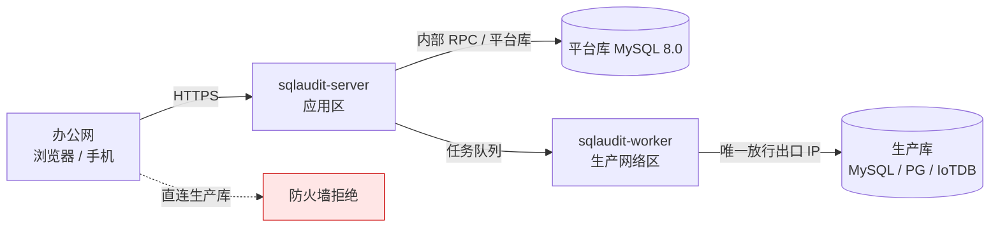
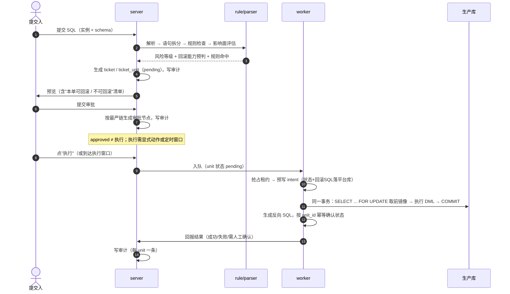
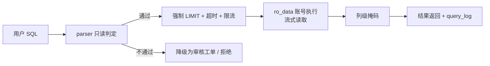

# SQL 审核平台设计文档（v2.1 · 可落地版）

> 版本：v2.1（v2 架构评审后修订）｜日期：2026-11-22｜目标读者：后端 / DBA / 运维
> 本文取代《SQL审核平台设计方案（MVP）》全部内容，可直接作为开发依据。
> v2 → v2.1 修订清单见 §0 末尾。标注「**v2.1 修正**」的段落是开发必读项，照 v2 实现会出正确性问题。

---

## 0. 结论与设计原则

**三条硬原则，先于一切细节：**

1. **平台是办公网通往生产库的唯一通道。** 办公网与生产库网络不通是既定事实；因此无论变更还是查询，都必须经过平台。这一条同时解决了 v1 最大的逻辑漏洞——"用 DBeaver 直连只读账号"会让查询审计彻底失效。网络层只放行平台 Worker 的出口 IP，审计覆盖率天然是 100%。
2. **执行前必须回答"这一单能不能回滚"。** 回滚不是事后的安慰剂，而是**准入门槛**：解析不出回滚 SQL 的高危变更，要么拒绝执行，要么强制走影子表 / 快照 / binlog 兜底，绝不允许"先执行、出事再说"。平台对回滚能力的诚实披露，比覆盖率本身更重要。
3. **SQL 执行是"至少一次、副作用不可重复"的操作。** 队列、状态机、回滚生成全部围绕幂等设计：同一 unit 在任何故障场景下都不能执行两遍。

**优先级（按用户定义）：**

| 级别 | 目标 | 验收标准 |
|---|---|---|
| P0 | SQL 审核 + 尽可能生成回滚 SQL（MySQL / PostgreSQL / IoTDB） | 变更 SQL 100% 过审核；可回滚语句生成率 ≥90%；不可回滚语句执行前明确拦截 |
| P1 | 线上 SQL 查询平台 | 办公网经平台可查生产库；查询 100% 留痕；超时/行数/限流三重保护生效 |
| P2 | 全量操作审计 | 登录、配置、工单、审批、查询、执行、回滚、导出，每人每步可追溯且不可篡改 |

**v1 问题 → v2 决策（取舍表）：**

| v1 问题 | v2 决策 |
|---|---|
| PG `BEGIN; DML; ROLLBACK` 试跑会在生产库真跑 | 审核只用 `EXPLAIN`（无 ANALYZE）；试跑一律在影子/克隆实例 |
| 前镜像在提交时生成，审批几小时后快照失效 | 前镜像在 **Worker 执行时刻、同一连接、同一事务**内生成 |
| DB 队列无租约，崩溃重跑会把 DDL 执行两遍 | 租约 + 心跳 + 预写 intent + `unit_id` 幂等确认 + 人工确认态 |
| MySQL 照搬 PG 的 `RETURNING` | MySQL 用 `LAST_INSERT_ID()`；批量/复杂 INSERT 明确标 `not_available` |
| 无主键表也生成反向 UPDATE | 无主键 = 拒绝或标不可回滚（硬规则） |
| DDL 备份主推 `CREATE TABLE ... AS SELECT` | 改为 `RENAME TABLE` 影子表；CTAS 明确禁用 |
| `EXPLAIN rows` 当风险分级依据 | 改用只读副本 `SELECT COUNT(*)`（带超时），EXPLAIN 仅作提示 |
| 「不做在线查询」与查询审计自相矛盾 | 查询通道升为一等公民，且因网络隔离成为唯一出口 |
| 规则"命中第一条生效"可让高危被降级 | 命中规则中取**审批链最严**的；高危规则不可被覆盖 |
| hash 链宣称"防篡改" | 明确只防无意篡改；链头定期外置；并发写串行化 |
| 沿用 v1 品牌名「御数 DataWarden」及 `warden-*` 模块前缀 | 内部工具定位，定名「SQL 审核平台」、工程名 `sqlaudit`，模块统一 `sqlaudit-*` |
| 数据模型漏 6 张表、`approval` 字段两套 | 第 9 章给出完整表清单与关键 DDL |

### v2 → v2.1 修订清单

分两类：**正确性缺陷**（照 v2 写会出错）与**规格缺口**（v2 没说清，开发会各写各的）。

| # | 类型 | v2 问题 | v2.1 修正 | 章节 |
|---|---|---|---|---|
| 1 | 正确性 | PG 执行事务未指定隔离级别。READ COMMITTED 下 `FOR UPDATE` 锁不住并发新插入的行，DML 会改到前镜像里没有的行 → 回滚不完整 | PG 执行事务**强制 REPEATABLE READ**；MySQL 保持 RR 默认且禁止降级（next-key lock 已覆盖间隙） | §5.3 |
| 2 | 正确性 | `executed_at` 加唯一约束 | 两个 unit 同毫秒完成就会违约。改为 `unit_id` 条件 UPDATE 做幂等，`executed_at` 去唯一约束 | §3.3 |
| 3 | 正确性 | 抢占 SQL 只匹配 `status='pending'`；worker 崩在执行中的行是 `status='executing'`，永远回收不到 | 抢占覆盖 `pending/leased`；`executing` 的过期租约由**独立 reaper** 按 `intent_written` 分流，不进抢占池 | §3.3 |
| 4 | 正确性 | `rollback_sql.reverse_sql VARBINARY(4096)` 与「前镜像上限 5 万行」矛盾，5 万行反向 UPDATE 装不进 4KB | 反向语句拆 `rollback_statement` 子表（`BLOB`）；超阈值转对象存储只存 URI | §5.9 |
| 5 | 正确性 | 破坏性 DDL 一律「RENAME 影子表」。`DROP COLUMN` / `MODIFY COLUMN` 不是整表操作，RENAME 救不了 | 拆两类：整表级（DROP/TRUNCATE）走 RENAME；列级走 online DDL + 列投影备份 | §5.6 |
| 6 | 正确性 | 反向 INSERT 用 `SELECT *` 前镜像 | 生成列（VIRTUAL/STORED）不能出现在 INSERT 列表，必须按 `information_schema` 排除 | §5.3 |
| 7 | 正确性 | 查询通道「自动追加 LIMIT 1000」用字符串拼接 | 原 SQL 已有 LIMIT / UNION / 重名列时拼接会出错或改变语义。改 **AST 注入** + `setMaxRows` + 流式读取三重保护 | §6.2 |
| 8 | 规格 | 无「同实例同对象并发执行」约束，两张工单同时改一张表会让前镜像依赖检测失效 | 新增 `exec_lock`：同一 instance（可选同对象）同时只跑一个 unit | §3.3 / §3.5 |
| 9 | 规格 | 审批到执行之间表结构可能已变，unit 按旧结构生成 | 执行前校验 DDL 指纹（`SHOW CREATE TABLE` 哈希），不一致则拒绝执行并退回重审（`R_SCHEMA_DRIFT`） | §3.5 |
| 10 | 规格 | 执行后没有对账，affected_rows 与前镜像行数不一致也照样标 success | 硬门禁：两者不等 → `needs_confirm` + 告警。附 Connector/J `useAffectedRows=false`（默认，返回 matched rows）前提 | §3.3 / §5.3 |
| 11 | 规格 | hash 链公式有了，但 `canonical_json` 字段序、加密字段算明文还是密文、创世块 `prev_hash` 都没定义，两个人实现出来的链互不兼容 | 给出字段序、**哈希算明文**（密钥轮换不破链）、创世 `prev_hash = 64×'0'`、`chain_head` 单写入点 | §7.3 |
| 12 | 规格 | `audit_log` 同时有自增 `id` 和唯一 `seq`，两套单调序；自增值并发下不保证提交有序，按 id 串链会错 | `seq` 由 `chain_head` 行锁内分配，`id` 只做物理主键不参与链 | §7.2 |
| 13 | 规格 | §1.3 要求审核接口 P95 < 500ms，§4.4 的 `COUNT(*)` 超时 3s，同一个接口两套口径 | 拆成两个 SLO：规则审核同步 < 500ms；影响面评估**异步**，前端轮询 | §1.3 / §4.4 |
| 14 | 规格 | 「可回滚生成率 ≥90%」没定义分母，且被 `R_ROLLBACK_UNAVAILABLE` 拦掉的语句不进统计 → 指标自我实现 | 明确分母为「提交预审的变更语句数」，被拦截语句单独报「拦截率」 | §10 |
| 15 | 规格 | 前镜像 5 万行上限按平台库容量定，没考虑 `FOR UPDATE` 锁 5 万行的线上风险 | 上限按**锁持有时长 / 从库延迟**定；大批量改按主键分片、每片独立事务 | §5.3 |
| 16 | 规格 | 「一条语句 = 一个 unit」隐含了「工单不是事务」，但没写明 | §3.2 显式声明：部分成功是常态，需要原子性的变更由提交人自己拆成幂等语句 | §3.2 |
| 17 | 规格 | 平台库自身的变更没人管（它存着全部生产库凭据与审计） | 平台库作为实例注册进平台自身，自己的 DDL 也走工单；直连访问单独审计 | §11 |

---

## 1. 目标与约束

### 1.1 功能范围

**做（v2 首版）：**
- 三方言审核：MySQL 8.0 / PostgreSQL 14+ / Apache IoTDB 1.x。
- 变更工单：提交 → 自动审核 → 风险分级 → 人工审批 → 执行 → 结果归档。
- 回滚 SQL 生成、校验、审批、执行（含有效期与依赖检测）。
- 线上只读查询通道（免审查询自动放行，危险/大查询降级走审核）。
- 全量审计日志（append-only + hash 链 + 链头外置）。
- 企微 OAuth 登录 + 本地应急账号、RBAC、实例/凭据管理。

**不做（明确边界，避免范围蔓延）：**
- 不做 BI / 报表 / 数据可视化、不做数据建模、不做数据库性能诊断平台。
- 不做自动备份恢复调度（依赖现有备份体系，平台只调快照并记录位置）。
- 不做多语句事务脚本编排：**一条语句 = 一个 unit = 一次执行**；需要事务的脚本走"白名单 + 人工审核 + 单连接串行"特殊通道（P3）。
- 不做全库数据脱敏（P3 只做列级掩码 + 导出审批）。
- 不做多租户隔离（单公司单实例，靠 `environment` 字段区分 prod/staging）。

### 1.2 网络与部署约束（硬约束）



- 防火墙策略：**仅 worker 出口 IP 可访问生产库端口**；办公网到生产库全阻断。这是"每个人操作都留痕"的物理前提，不能用应用层约定替代。
- `sqlaudit-server` 与 `sqlaudit-worker` 分离进程；worker 可多实例，靠租约抢占（§3.3）。
- 平台库单实例起步，但必须配每日备份 + 季度恢复演练（§11）。

### 1.3 非功能约束

| 项 | 要求 |
|---|---|
| 安全 | 凭据加密存储、三类账号最小权限、SQL 全文加密落审计、结果集列级掩码 |
| 可靠性 | 执行幂等、故障进人工确认态而非自动重试、平台库备份可恢复 |
| 可观测 | 队列积压、执行失败、凭据过期、审计容量水位四类告警（企微） |
| 性能 | **规则审核**（纯 AST + 本地规则）同步返回，P95 < 500ms；**影响面评估**（只读副本 `COUNT(*)`，超时 3s）异步执行，前端轮询，不计入审核接口 SLO；查询通道 P95 < 2s（受语句本身限制） |
| 合规 | 审计保留 ≥180 天，到期归档不删除；所有写操作可追溯到人 |

---

## 2. 总体架构

### 2.1 组件职责

| 组件 | 职责 | 是否触碰生产库 |
|---|---|---|
| `sqlaudit-server` | Web/API、登录鉴权、工单与流程、审核调度、查询入口、审计写入 | 否（只连平台库） |
| `sqlaudit-parser` | 三方言解析 → 统一 AST / 语句类型 / 对象列表 | 否 |
| `sqlaudit-rule` | 规则引擎、风险分级、影响面评估 | 否（元数据只读账号） |
| `sqlaudit-rollback` | 前镜像采集、反向 SQL 生成、有效期/依赖检测 | 否（生成逻辑），执行时在 worker 内 |
| `sqlaudit-query` | 只读查询执行、超时/行数/限流、结果掩码 | 是（仅数据只读账号） |
| `sqlaudit-executor` | unit 抢占、预写 intent、SQL 执行、幂等确认 | 是（执行账号） |
| `sqlaudit-worker` | executor + query 的运行进程，独立部署 | 是 |
| `sqlaudit-audit` | append-only 写入、hash 链、链头外置、检索导出 | 否 |
| `sqlaudit-storage` | 平台库访问、凭据加解密、对象存储（冷日志/快照） | 否 |
| `sqlaudit-auth` / `sqlaudit-workflow` / `sqlaudit-common` | 认证、流程、公共模型 | 否 |

### 2.2 三类生产库账号（物理隔离）

| 账号类型 | 权限 | 使用阶段 | 备注 |
|---|---|---|---|
| **元数据只读** `ro_meta` | `SELECT` on `information_schema` / `pg_catalog`、`SHOW CREATE TABLE`、`EXPLAIN` | 审核阶段：DDL 逆向、规则检查、执行计划 | 不能读业务表数据 |
| **数据只读** `ro_data` | `SELECT` on 业务表 | 查询通道、影响面 `COUNT(*)`（走只读副本） | 无写权限；IoTDB 用只读 Session。**不负责前镜像采集**（见下） |
| **执行账号** `rw_exec` | DML + DDL，`DROP` / `TRUNCATE` 单独授权 | 执行阶段、**前镜像采集** | 默认**不授** DROP；破坏性 DDL 走独立授权 + 影子表流程 |

> **v2.1 修正**：前镜像必须用 `SELECT ... FOR UPDATE`，只读账号加不了行锁，且前镜像与 DML 必须同事务 → 前镜像只能走 `rw_exec`。v2 把它挂在 `ro_data` 上与 §5.3 自相矛盾，按本表为准。

- 每实例一套账号，互不复用的凭据。
- 凭据用 **AES-GCM** 加密存 `credential` 表，主密钥走环境变量 / KMS，不落配置文件、不进日志、不进审计 `detail`。
- 查看凭据（解密动作）本身写审计：谁、何时、看了哪个实例；页面不回显完整密码。
- 凭据轮换周期 90 天，过期前 14 天告警。

### 2.3 技术栈与工程结构

| 层 | 选型 | 说明 |
|---|---|---|
| 语言 / 框架 | Java 17 + Spring Boot 3.x | 与团队现状一致 |
| ORM / 连接池 | MyBatis-Plus + HikariCP | 平台库与生产库连接池**物理隔离**，各自独立配置 |
| 平台库 | MySQL 8.0 | 单实例起步 + 每日备份 |
| 缓存 / 限流 | Redis（P1 引入） | refresh token 撤销、查询并发限流、分布式锁 |
| MySQL 解析 | Alibaba Druid SQL Parser | AST Visitor 做规则检查 |
| PG 解析 | `libpg_query` 的 Java 绑定（pg_query_java） | 真实 PG 语法树；退化方案见 §4.1 |
| IoTDB | `iotdb-session` + 官方 `IoTDBSql*.g4` 片段（P2） | MVP 不做完整 AST |
| 前端 | Vue 3 + Element Plus | |
| 任务队列 | 平台库表 + 租约（不引 MQ） | 见 §3.3 |

**模块命名全量统一为 `sqlaudit-*`，打包命令与模块名一致：**

```
sqlaudit-common        公共模型 / 枚举 / 异常
sqlaudit-parser        三方言解析、AST 归一化
sqlaudit-rule          规则引擎、风险分级、影响面评估
sqlaudit-rollback      前镜像、反向 SQL、有效期与依赖检测
sqlaudit-executor      unit 抢占、幂等执行、结果确认
sqlaudit-query         查询通道、限流、掩码
sqlaudit-auth          登录、JWT、RBAC、凭据加解密
sqlaudit-workflow      工单状态机、审批流
sqlaudit-audit         审计写入、hash 链、链头外置
sqlaudit-storage       平台库 DAO、对象存储
sqlaudit-server        API / Web 入口（可独立部署）
sqlaudit-worker        executor + query 运行进程（可多实例）
```

```bash
# 打包（模块名与命令严格一致）
mvn -pl sqlaudit-server -am clean package -DskipTests
mvn -pl sqlaudit-worker -am clean package -DskipTests
```

> 部署时 `sqlaudit-server` 关闭任务轮询开关，仅 `sqlaudit-worker` 开启；两者共用同一套平台库配置。

---

## 3. 核心链路：一次变更工单的生命周期

### 3.1 时序



**关键点：前镜像采集与 DML 执行在同一个 JDBC Connection、同一个事务内。** 审核/审批阶段绝不提前生成回滚快照（v1 的致命错误）。

### 3.2 状态机

**ticket：** `draft → submitted → auditing → (approved | rejected) → scheduled → executing → (succeeded | partially_succeeded | failed | needs_confirm) → closed`；任意态可 `cancelled`；`approved` 超时未执行 `expired`。
- `approved` 表示"批准但尚未执行"；执行由**显式动作**触发（提交人/DBA 点执行）或配置的低峰窗口自动触发，且审批页面明确提示"通过后将于 X 执行"，责任边界清晰。
- `needs_confirm`：SQL 可能已在生产库生效但平台库状态未确认，**禁止自动重试**，由人工核对后标记 succeeded/failed。

**ticket_unit：** `pending → leased → executing → (success | failed | skipped)`；异常超时回收回 `pending`（但仅在确认 intent 未提交时，见 §3.3）。

> **v2.1 补充 · 工单不是事务。** 「一条语句 = 一个 unit = 一次执行」意味着多语句工单**没有原子性**：unit#1 成功、unit#2 失败是正常结果，系统只保证「每个 unit 不执行两遍」，不保证「全成功或全不做」。因此：
> - 需要原子性的变更，由提交人自己保证每条语句**幂等可重入**，或拆成互不依赖的工单；
> - 提交预览页必须显式提示「本工单不是一个事务，部分成功需按 unit 回滚」；
> - 部分成功的工单状态为 `partially_succeeded`，回滚按 `unit_order` 倒序且只回滚 `success` 的 unit（§5.9）。

**rollback_ticket：** 独立工单，`pending → approved → executing → applied | rejected | expired`；按原 unit **倒序**执行，只回滚 `success` 的 unit。

### 3.3 任务队列与幂等（最高优先级工程约束）

`task_queue` 即 `ticket_unit` 表，抢占字段：

```sql
lease_owner      VARCHAR(64)  NULL COMMENT 'worker 实例 ID',
lease_until      DATETIME(3)  NULL COMMENT '租约到期 = now + 30s',
heartbeat_at     DATETIME(3)  NULL COMMENT '心跳，每 5s 续租；TTL 必须 ≥ 心跳间隔×3',
intent_written   TINYINT(1)   NOT NULL DEFAULT 0 COMMENT '1 = 已预写执行意图，SQL 可能已到生产库',
executed_at      DATETIME(3)  NULL COMMENT '幂等确认时间戳（不加唯一约束，见下）',
exec_fingerprint CHAR(64)     NULL COMMENT 'SHA256(instance_id|statement_hash|unit_id)，跨工单重复提交检测',
preimage_rows    BIGINT       NULL COMMENT '前镜像行数，用于与 affected_rows 对账',
```

**不变式（实现时写成断言）：** `intent_written=1` 只能出现在 `status IN ('executing','success','failed','needs_confirm')`；`status='executing'` 必然 `intent_written=1`。二者同事务写入，不存在中间态。

抢占与执行协议：

1. **抢占**（覆盖 `pending` 与租约已过期的 `leased`）：
   ```sql
   UPDATE ticket_unit
      SET lease_owner=?, lease_until=NOW(3)+INTERVAL 30 SECOND, heartbeat_at=NOW(3), status='leased'
    WHERE id=? AND intent_written=0
      AND status IN ('pending','leased')
      AND (lease_until IS NULL OR lease_until < NOW(3));
   ```
   影响行数 1 才算抢到。**`intent_written=0` 是抢占的硬条件**——已预写的 unit 永远不进抢占池。
2. **抢执行锁**（v2.1 新增，防并发）：按 §3.5 取 `exec_lock`，同一 instance 同时只跑一个 unit。拿不到锁则释放租约、退回 `pending`。
3. **预写 intent**：同一平台库事务内写 `status='executing'`、`intent_written=1`、回滚 SQL 骨架（不含前镜像值）；**事务提交后才允许连生产库**。
4. 连生产库，单事务内完成（隔离级别见 §5.3）：前镜像采集 → 执行 SQL → **affected_rows 对账** → COMMIT → 用前镜像补全回滚 SQL → 幂等确认。
5. **幂等确认用条件 UPDATE，不用唯一约束**：
   ```sql
   UPDATE ticket_unit SET status='success', executed_at=NOW(3), affected_rows=?
    WHERE id=? AND status='executing' AND executed_at IS NULL;
   ```
   影响行数 0 说明已有人确认过，直接返回成功，不重复执行。
   > **v2 错误**：`executed_at` 加唯一约束 → 两个 unit 同毫秒完成就会违反约束导致误判失败。`exec_fingerprint` 的唯一索引也**不是幂等手段**（unit_id 本身唯一，指纹必然唯一），它的真实用途是**跨工单重复提交检测**：同一实例同一语句短期内被不同工单重复提交时给出提示，因此应建普通索引 + 时间窗查询，不建唯一索引。
6. **租约回收由独立 reaper 做，不混在抢占里**（v2 漏洞：抢占 SQL 只匹配 `pending`，崩在执行中的行是 `executing`，永远回收不到）：
   | 现场 | 判定 | 动作 |
   |---|---|---|
   | `status IN ('pending','leased')` + 租约过期 + `intent_written=0` | SQL 一定没发出 | 清租约回 `pending`，可安全重跑 |
   | `status='executing'` + 心跳停滞 > TTL + `executed_at IS NULL` | **SQL 可能已执行** | 转 `needs_confirm`，**禁止自动重试**，企微告警 |
   | `status='executing'` + 心跳正常 | 长事务 DDL 正常执行中 | 不回收，只在超过 `max_exec_minutes` 时告警 |
   > 长时间 DDL（大表 ALTER）会让 unit 长期停在 `executing`，reaper **只认心跳不认耗时**，否则会把正常执行的 DDL 误判为死 worker。
6. 多 unit 工单部分失败：成功的 unit 保持 `success`，失败的保留现场，支持"一键续跑"（只跑 `failed`/`pending`，已成功的跳过）。

> 这条协议是整套系统里最不能省的部分：生产库 SQL 的成功与平台库状态的写入无法原子化，只能用"预写 intent + 幂等确认 + 人工兜底"逼近正确性。

### 3.4 权限与责任边界

- 提交人不得审批自己的工单（`approval.approver_id != ticket.creator_id` 硬校验）。
- **审批 ≠ 执行**：审批通过只到 `approved`；执行动作单独授权、单独审计。
- 高危工单执行前二次确认，由**审批人之外**的角色（DBA / 管理员）完成。
- 破坏性 DDL（`DROP` / `TRUNCATE` / `DROP COLUMN`）：执行账号默认无此权限，走独立授权 + 影子表流程（§5.6）。

### 3.5 执行前门禁（v2.1 新增）

审核通过到真正执行之间可能隔了几小时，世界已经变了。执行前必须重新校验四件事，任一不过则**不执行**：

| 门禁 | 校验 | 不过时的动作 |
|---|---|---|
| **并发互斥** | 取 `exec_lock`（见下） | 释放租约退回 `pending`，等下一轮 |
| **结构漂移** | 审核时记录 `ddl_fingerprint = SHA256(SHOW CREATE TABLE)`（PG 用 `pg_get_tabledef` 等价物），执行前重算比对 | `R_SCHEMA_DRIFT` → unit 置 `failed`，工单退回重审，告警 |
| **回滚能力复核** | 重新检查主键 / 触发器 / 外键 CASCADE 是否变化 | 回滚能力降级 → 按 `R_ROLLBACK_UNAVAILABLE` 策略阻断 |
| **审批时效** | `approved` 未超 `approval_ttl`（默认 24h） | 置 `expired`，需重新审批 |

**为什么要并发互斥：** 两张工单同时改同一张表时，A 的前镜像会包含 B 已改但未记录的行，回滚 A 就会把 B 的写入覆盖掉。§5.9 的「前镜像 hash 依赖检测」只能在**回滚时**发现问题（为时已晚），执行期必须直接避免交叉。

```sql
CREATE TABLE exec_lock (
  lock_key    VARCHAR(255) PRIMARY KEY COMMENT 'inst:{id} 或 inst:{id}:obj:{schema.table}',
  unit_id     BIGINT      NOT NULL,
  worker_id   VARCHAR(64) NOT NULL,
  acquired_at DATETIME(3) NOT NULL,
  expires_at  DATETIME(3) NOT NULL COMMENT '与租约同生命周期，过期由 reaper 清理'
);
```

- MVP 粒度 = **实例级**（`INSERT ... ON DUPLICATE KEY UPDATE` 判影响行数，或 `INSERT` 捕获主键冲突）。实例级最简单也最安全，代价是同实例的工单串行；创业公司的工单量下这个代价可以接受。
- P2 可降到**对象级**（`inst:{id}:obj:{schema.table}`），但 DDL 必须仍取实例级锁，避免「DDL 改结构 + DML 用旧结构」交叉。
- 锁与租约同生命周期：reaper 回收租约时一并清锁，避免 worker 崩溃后锁永久泄漏。

---

## 4. SQL 审核引擎

### 4.1 三方言解析策略

| 方言 | 主方案 | 覆盖 | 退化/兜底 |
|---|---|---|---|
| MySQL 8.0 | Druid SQL Parser → `SQLStatement` → Visitor | DDL/DML/部分 DCL | 解析失败 → 高危人工审 |
| PostgreSQL 14+ | `libpg_query` Java 绑定 → 真实 PG 语法树 | 完整 PG 语法 | 引入成本高时：Druid PG 模式 + **白名单**；解析失败一律高危 |
| IoTDB 1.x | MVP：`iotdb-session` + 语句类型白名单（不做 AST） | `CREATE DATABASE/TIMESERIES`、`INSERT`、`DELETE`、`DROP ...` | P2 引入官方 `IoTDBSqlParser.g4` 生成的解析器 |

**通用铁律：解析失败 = 高危 = 必须人工审核，绝不"降级放行"或假装解析成功。** v1 中"Druid 解析不出来降级 JSqlParser"不可靠（JSqlParser 对 PG 同样有限），本版取消该降级路径。

解析器输出统一中间模型：

```
ParsedStatement {
  dialect, statementType(SELECT/INSERT/UPDATE/DELETE/DDL/OTHER),
  objects: [{schema, name, type}],
  isReadOnly, dangerousClauses[], whereAst, limitAst,
  containsSubquery, containsFunction, affectsPrimaryKey,
  originalSql, normalizedSql, parseConfidence
}
```

### 4.2 只读判定（查询免审的准入门槛）

只用 AST 白名单，不用正则。以下任一命中即 **not readOnly**，强制走审核工单：

| 危险子句 / 形态 | 原因 |
|---|---|
| `EXPLAIN ANALYZE` | PG 会**真实执行** DML；MySQL 8.0.18+ 也会真实执行语句 |
| `SELECT ... FOR UPDATE` / `FOR SHARE` / `LOCK IN SHARE MODE` | 加行锁，影响线上 |
| `SELECT ... INTO OUTFILE` / `INTO DUMPFILE` / `INTO @var` | 写文件 / 会话状态 |
| PG `SELECT ... INTO new_table`、数据修改 CTE（`WITH ... DELETE/UPDATE/INSERT ... RETURNING`） | 实际写表 |
| 调用存储函数 / 存储过程 / 触发器副作用 | 函数内可能写表 |
| `SET` / `SHOW` 之外的会话变更、`CALL`、`LOCK TABLES` | 会话/锁副作用 |
| 解析置信度 < 阈值 | 无法证明只读 |

只读白名单还要求：单语句、无子查询写副作用、显式或平台强制追加 `LIMIT`。

### 4.3 规则模型

```sql
CREATE TABLE rule (
  id            BIGINT PRIMARY KEY AUTO_INCREMENT,
  code          VARCHAR(64)  NOT NULL UNIQUE COMMENT 'R_MYSQL_NO_WHERE 等',
  dialect       VARCHAR(16)  NOT NULL COMMENT 'MYSQL/PG/IOTDB/ALL',
  statement_type VARCHAR(16) NOT NULL COMMENT 'INSERT/UPDATE/DELETE/DDL/SELECT/ALL',
  severity      VARCHAR(8)   NOT NULL COMMENT 'ERROR 阻断 / WARN 提示',
  enabled       TINYINT(1)   NOT NULL DEFAULT 1,
  params        JSON         NULL COMMENT '阈值等',
  description   VARCHAR(255) NOT NULL,
  created_at    DATETIME(3)  NOT NULL DEFAULT CURRENT_TIMESTAMP(3)
);

CREATE TABLE rule_group (
  id          BIGINT PRIMARY KEY AUTO_INCREMENT,
  name        VARCHAR(64) NOT NULL,
  environment VARCHAR(16) NOT NULL COMMENT 'prod/staging',
  created_by  BIGINT NOT NULL
);

CREATE TABLE rule_group_binding (
  group_id    BIGINT NOT NULL,
  instance_id BIGINT NOT NULL,
  PRIMARY KEY (group_id, instance_id)
);
```

- `ERROR` 阻断提交；`WARN` 只提示。豁免必须走审批并写审计（谁豁免了哪条规则、原因）。
- 规则命中结果落 `audit_result(unit_id, rule_code, level, message, extra)`。
- 内置规则（首版 27 条，按方言分组）：

| code | 检查 | 级别 |
|---|---|---|
| `R_NO_WHERE` | UPDATE/DELETE 无 WHERE | ERROR |
| `R_NO_PK` | 目标表无主键（影响回滚能力） | ERROR（DML） |
| `R_FULL_TABLE_SCAN` | WHERE 列无可用索引（EXPLAIN 提示） | WARN |
| `R_AFFECT_TOO_MANY` | `COUNT(*)` 超阈值（默认 10 万） | ERROR → 强制 DBA 节点 |
| `R_DDL_DESTRUCTIVE` | DROP / TRUNCATE / DROP COLUMN / MODIFY COLUMN | ERROR → 影子表流程 |
| `R_DDL_NO_IF_EXISTS` | 危险 DDL 未带幂等保护 | WARN（不改写用户 SQL，见下） |
| `R_SELECT_STAR` | `SELECT *` 于变更语句 | WARN |
| `R_LIMIT_ORDER_DML` | UPDATE/DELETE 带 LIMIT/ORDER BY（回滚不可靠） | ERROR |
| `R_NONDETERMINISTIC_SET` | `SET c=c+1` / `NOW()` / 子查询（前镜像失效） | ERROR → 标不可回滚 |
| `R_MULTI_TABLE_DML` | 多表 JOIN UPDATE/DELETE | ERROR → 标不可回滚 |
| `R_NO_LIMIT_QUERY` | 查询通道无 LIMIT | ERROR（平台自动补 LIMIT） |
| `R_SENSITIVE_COLUMN` | 命中掩码列且未授权 | ERROR |
| `R_SQL_INJECTION_PATTERN` | 拼接痕迹 / 注释绕过 | ERROR |
| `R_OBJECT_NOT_ALLOWED` | 目标对象不在实例白名单 | ERROR |
| `R_INDEX_NAME` / `R_TABLE_NAME` | 命名规范 | WARN |
| `R_ALTER_LOCK` | 预估锁表时长超阈值 | WARN |
| `R_IOTDB_DROP` | IoTDB DROP DATABASE / TIMESERIES | ERROR → 快照流程 |
| `R_IOTDB_NO_TIME_RANGE` | DELETE 无时间范围 | ERROR |
| `R_IOTDB_TTL` | TTL / 模板变更 | WARN |
| `R_TX_DDL_MIX` | 单工单混合 DDL 与 DML | WARN |
| `R_BIG_UNIT_COUNT` | 单工单 unit 数超阈值（默认 200） | WARN |
| `R_PARSE_FAILED` | 解析失败 | ERROR → 人工审 |
| `R_ROLLBACK_UNAVAILABLE` | 无法生成回滚 SQL | ERROR（策略可配：拒绝 / 强制兜底） |
| `R_LOW_PEAK_WINDOW` | 影响行数超「建议低峰」阈值（默认 1 千）但未达阻断阈值 | WARN（v2.1 新增，与 `R_AFFECT_TOO_MANY` 分离） |
| `R_PREIMAGE_TOO_LARGE` | 预估前镜像行数 / 字节超上限（§5.3） | ERROR → 转分片执行 / binlog / 快照 |
| `R_SCHEMA_DRIFT` | 执行前 DDL 指纹与审核时不一致（§3.5） | ERROR → 退回重审（执行期规则，不在提交期触发） |

> **v2.1 修正**：v2 把「超 10 万阻断」和「建议低峰执行」都挂在 `R_AFFECT_TOO_MANY` 上，导致 UI 出现「命中 R_AFFECT_TOO_MANY（WARN）· 未达 10 万阈值」这种自我矛盾的提示。两件事拆成两条规则：`R_AFFECT_TOO_MANY` 只做 ERROR 阻断，低峰建议归 `R_LOW_PEAK_WINDOW`。

> **不改写用户 SQL**：平台不自动给 DDL 加 `IF NOT EXISTS`（v1 的做法会吞掉"列已存在应报错"的意图，且 MySQL 对 `ADD COLUMN IF NOT EXISTS` / `CREATE INDEX IF NOT EXISTS` 本就不支持）。幂等靠 unit 状态机与执行前元数据检查实现。

### 4.4 影响面评估

- `EXPLAIN` 的 `rows` 是优化器估算值，**不得作为风险分级或免审依据**（统计信息过期可差几个数量级）。
- 实际影响行数：用 `ro_data` 账号在**只读副本**上按原 WHERE 执行 `SELECT COUNT(*)`，带 `statement_timeout`（默认 3s）；超时 / 失败 → 直接升为高危，要求人工评估。
- **v2.1 补充 · 三个前提必须写进实现**：
  1. **异步执行**。`COUNT(*)` 超时 3s，装不进 §1.3 的「审核接口 P95 < 500ms」。规则审核同步返回，影响面评估另起任务，前端轮询 `audit_result`；评估未完成的工单**不允许提交审批**。
  2. **没有只读副本时的降级**。不是每个实例都有副本（IoTDB 更没有「只读副本」概念）。实例配置里加 `replica_dsn`，为空时：① 允许在主库跑 `COUNT(*)` 但超时压到 1s 且需实例 Owner 预先开关授权；② 否则直接标「影响面未知」→ 风险等级升一级。**不要默默回退到 EXPLAIN rows**。
  3. **估算值会过期**。评估时刻与执行时刻之间数据会变，`COUNT(*)` 只用于风险分级，不作为执行期的正确性依据；执行期的真实值由 affected_rows 对账给出（§3.3）。无索引列的 `COUNT(*)` 本身就是全表扫，大表上要靠超时兜住。
- 大表阈值触发 `R_AFFECT_TOO_MANY` → 强制追加 DBA 审批节点，并建议低峰执行。
- dry-run 只用 `EXPLAIN`（不带 ANALYZE）；**禁止 `BEGIN; DML; ROLLBACK` 在生产库试跑**（ROLLBACK 撤不掉触发器副作用、sequence nextval、锁、WAL、dblink/fdw 外部调用）。需要真实试跑时，在影子库/克隆实例执行，结果只作参考。

### 4.5 风险分级 → 审批路由

| 等级 | 判定 | 审批链 |
|---|---|---|
| LOW | 只读查询 / 低危且 staging | 自动通过，留痕 |
| MEDIUM | 常规 DML、影响行数 < 阈值 | 主管 1 人 |
| HIGH | 高危规则、prod 大表变更、DDL | 主管 + DBA |
| CRITICAL | 破坏性 DDL、不可回滚变更、跨库批量 | 主管 + DBA + 管理员，且执行前二次确认 |

**路由算法（修 v1 漏洞）：** 收集所有命中的 `flow_rule`，取**审批链最严**的一条，而非"命中第一条生效"；`CRITICAL` 规则带 `non_overridable=1`，任何配置都不能把它降级。配置变更本身写审计。

---

## 5. 回滚 SQL 生成与执行（P0 核心）

### 5.1 立场

用户把回滚 SQL 当作事故处理手段，因此平台必须先说清楚**能力边界**：提交预览时给出「本单可回滚 / 不可回滚」清单，不可回滚的高危语句按策略拒绝执行或强制兜底。事后才发现"回滚不了"是不可接受的设计缺陷。

### 5.2 覆盖率矩阵

| 语句 | MySQL | PostgreSQL | IoTDB | 手段 |
|---|---|---|---|---|
| `UPDATE ... WHERE`+主键+确定性 SET | ✅ | ✅ | n/a | 前镜像 → 反向 UPDATE |
| `DELETE ... WHERE` | ✅ | ✅ | 部分 | 前镜像 → 反向 INSERT |
| `INSERT` 单条、有显式/自增主键 | ✅(last_insert_id) | ✅(RETURNING) | ❌ | 反向 DELETE |
| 批量 INSERT / `INSERT...SELECT` / `ON DUPLICATE` / `REPLACE` | ❌ | ⚠️(RETURNING 多行可覆盖) | ❌ | 标 `not_available` → binlog 闪回 / 拒绝 |
| 无主键表 DML | ❌ | ❌ | n/a | 硬规则拒绝 |
| 函数 / 表达式 SET、触发器级联、外键 CASCADE | ❌ | ❌ | n/a | 标 `not_available` + 风险提示 |
| 可逆向 DDL（CREATE TABLE / ADD COLUMN / CREATE INDEX / RENAME） | ✅(带前置条件) | ✅(带前置条件) | ❌ | 生成反向 DDL |
| 破坏性 DDL（DROP / TRUNCATE / DROP COLUMN / MODIFY） | ⚠️ | ⚠️ | ❌ | **影子表 / 快照**，不生成 SQL |
| IoTDB 写入 / 删除 | n/a | n/a | ❌ | 快照恢复 SOP，不生成 SQL |

> 目标：可回滚语句生成率 ≥90%（按工单数统计）；剩余 10% 必须在执行前显式告知并拦截。

### 5.3 生成时机与事务边界（v1 致命错误修正）

```
[审核/审批阶段]   ❌ 不采集前镜像、不生成回滚 SQL（审批可能耗时数小时，快照必然失效）
[执行时刻 Worker] ✅ 单 Connection / 单 Transaction:
                     BEGIN
                       SELECT ... FOR UPDATE  -- 前镜像，WHERE 与原语句完全一致（含 LIMIT）
                       UPDATE / DELETE / INSERT  -- 原语句
                     COMMIT
                     用前镜像补全 rollback_sql，按 unit_id 幂等落库
```

#### 隔离级别：v2 最隐蔽的正确性缺陷

v2 只说了「同一事务」，没说隔离级别。**PG 默认 READ COMMITTED 下这套协议是错的：**

```
T1（worker）: BEGIN;
T1: SELECT ... WHERE status=1 FOR UPDATE;   -- 锁住当前可见的 100 行，拿到前镜像
T2（业务）  : INSERT 一行 status=1; COMMIT;   -- 新行，T1 的 FOR UPDATE 锁不到它
T1: UPDATE ... WHERE status=1;               -- READ COMMITTED 每条语句取新快照 → 改了 101 行
T1: COMMIT;
```

前镜像 100 行、实际改 101 行，反向 UPDATE 漏掉第 101 行 → **回滚不完整，且无人知晓**。

| 方言 | 要求 | 原因 |
|---|---|---|
| **PostgreSQL** | 执行事务**显式 `SET TRANSACTION ISOLATION LEVEL REPEATABLE READ`** | RR 下整个事务用同一快照，T2 的新行对 T1 不可见，UPDATE 与前镜像行集严格一致；有并发冲突时 PG 直接抛序列化失败让事务整体回滚（安全的失败） |
| **MySQL InnoDB** | 保持默认 RR，**禁止连接串/会话降级为 RC** | RR 下 `FOR UPDATE` 走 next-key lock 锁住间隙，T2 的 INSERT 会被阻塞，不会出现幻行 |

实现要点：worker 连接池初始化时固定隔离级别，并在每次执行前 `assert` 当前会话隔离级别，不信任默认值（云厂商和中间件都可能改默认）。

#### affected_rows 对账（硬门禁）

COMMIT 前比对 `affected_rows == preimage_rows`，不等则**回滚事务**并转 `needs_confirm` + 告警。这是隔离级别之外的第二道防线。

- MySQL 前提：Connector/J 的 `useAffectedRows` 保持**默认 false**（等价 `CLIENT_FOUND_ROWS`），此时 `getUpdateCount()` 返回 **matched rows** 而非 changed rows，才能与前镜像行数直接比对。若有人把它改成 `true`，`SET a=a` 这种值未变的行不计数，对账会误报——这个参数要写进连接池配置白名单并在启动时校验。
- DELETE 天然相等；INSERT 不适用（无前镜像）。

#### 其余约束

- 前镜像 SELECT 复用原语句的 WHERE。**v2.1 修正**：v2 这里写「含 LIMIT / ORDER BY」，但 `R_LIMIT_ORDER_DML` 已把带 LIMIT/ORDER BY 的 UPDATE/DELETE 判为 ERROR 阻断，二者矛盾。以规则为准：**带 LIMIT / ORDER BY 的 DML 不允许进入执行环节**，前镜像不存在需要复现 LIMIT 的场景。
- 前镜像列集合要**排除生成列**：MySQL 的 `VIRTUAL` / `STORED` 生成列、PG 的 `GENERATED ALWAYS AS` 列不能出现在反向 INSERT 的列清单里（会报 `The value specified for generated column ... is not allowed`）。按 `information_schema.columns.extra` / `is_generated` 过滤，不要图省事用 `SELECT *` 直接回填。
- 值序列化要处理：二进制 / JSON / 空间类型、`NULL` 三值逻辑、字符集、时区、浮点精度、转义与 SQL 注入（回滚 SQL 的值**参数化存储**，展示时才拼字面量）。
- **前镜像上限按线上风险定，不按平台库容量定**（v2.1 修正）。`SELECT ... FOR UPDATE` 5 万行会在整个事务期间持有 5 万行锁（MySQL 还含间隙锁），锁等待和从库延迟的风险远大于平台库写入压力。
  - 默认上限：单 unit 前镜像 **5000 行** / 16MB，且事务总时长超 `max_tx_seconds`（默认 5s）直接中止；
  - 超限的大批量变更走**主键分片**：按 PK 区间拆成多个 unit，每片独立事务 + 独立前镜像 + 独立反向 SQL，回滚时倒序逐片执行；
  - 分片仍超限 → `R_PREIMAGE_TOO_LARGE` 阻断，转 binlog 闪回 / 快照。
- 生成后做语法自检（用同方言 Parser 解析回滚 SQL），失败标 `not_available`。

### 5.4 MySQL DML

**前置硬检查（任一不满足 → `not_available` 并阻断）：** 目标表有主键；单表；`SET` 全为确定性字面量；无 JOIN / 子查询 / LIMIT / ORDER BY；元数据检查无触发器、无 `ON UPDATE CASCADE` 外键。

| 原语句 | 前镜像 | 反向 SQL |
|---|---|---|
| `UPDATE t SET a=1,b=2 WHERE pk IN (...)` | `SELECT pk,a,b FROM t WHERE <原 WHERE> FOR UPDATE` | `UPDATE t SET a=<旧a>,b=<旧b> WHERE pk=<pk>`（每行一条） |
| `DELETE FROM t WHERE <cond>` | `SELECT * FROM t WHERE <cond> FOR UPDATE` | `INSERT INTO t (col...) VALUES (...)` |
| `INSERT INTO t (...) VALUES (...)` | 同连接 `SELECT LAST_INSERT_ID()`（仅单条自增）；显式主键直接用 | `DELETE FROM t WHERE pk=<id>` |

`LAST_INSERT_ID()` 的已知限制写进代码注释：仅当前连接、仅单条自增有效；批量插入时并联写入会打断自增连续性，故批量一律标 `not_available`。

### 5.5 PostgreSQL DML

PG 的 `RETURNING` 在 DELETE / INSERT 上比 MySQL 简单可靠，**UPDATE 上并不简单**：

```sql
-- 在 Worker 的同一事务内，把原语句改写为带 RETURNING 的形式执行
UPDATE t SET a=1 WHERE <cond> RETURNING pk, a, b;  -- 返回的是"新值"
-- 前镜像仍需先查：SELECT pk,a,b FROM t WHERE <cond> FOR UPDATE;
DELETE FROM t WHERE <cond> RETURNING *;           -- 直接返回被删整行 → 反向 INSERT
INSERT INTO t (...) VALUES (...) RETURNING pk;     -- 直接拿主键 → 反向 DELETE
```

- **口径修正**：`UPDATE ... RETURNING` 返回的是**新值**，对回滚毫无用处，前镜像照样要先 `SELECT ... FOR UPDATE`。真正省事的只有两条：`DELETE ... RETURNING *`（一步拿到整行，省掉前置 SELECT）和 `INSERT ... RETURNING pk`（一步拿到主键，对应 MySQL 只能用 `LAST_INSERT_ID()` 且仅限单条）。
- **必须 REPEATABLE READ**（见 §5.3）。PG 默认 RC 下 `FOR UPDATE` 挡不住并发新插入的行，前镜像与 DML 行集会不一致。
- `FOR UPDATE` 与 `RETURNING` 可共存；在 RR 下前后镜像同属一个事务快照，一致性由 MVCC + 行锁保证。
- **PG 的 DDL 是事务性的**（MySQL 不是）：`CREATE/ALTER/DROP TABLE` 可以放进 `BEGIN ... ROLLBACK` 真正撤销。因此 PG 的 DDL 工单可以用「事务内执行 + 校验 + 显式 COMMIT」模式，拿到 MySQL 给不了的安全性；这一差异要在执行器里按方言分支，不要为了「统一」把 PG 的能力丢掉。MySQL 8.0 的 atomic DDL 只保证「不留半成品」，**不提供成功后的回滚**。
- 兜底：PITR / 逻辑复制解码（`wal2json`），需要先验证恢复点，写入运维 SOP。
- **禁止** `BEGIN; DML; ROLLBACK` 作为 DML 试跑手段（触发器副作用、sequence nextval、fdw 外部调用撤不掉）。注意这条限制针对 DML；PG 的 DDL 事务性是另一回事，见上。

### 5.6 DDL 回滚（禁用 CTAS）

**可逆向映射（生成反向 DDL，但带有效期与前置条件）：**

| 原 DDL | 反向 | 前置条件 |
|---|---|---|
| `CREATE TABLE t` | `DROP TABLE IF EXISTS t` | 窗口内未被写入（否则丢数据） |
| `ALTER TABLE t ADD COLUMN c` | `ALTER TABLE t DROP COLUMN c` | 窗口内 c 列无新数据写入 |
| `CREATE INDEX i ON t` | `ALTER TABLE t DROP INDEX i`（MySQL）/ `DROP INDEX i`（PG） | 无 |
| `RENAME TABLE a TO b` | `RENAME TABLE b TO a` | 应用未开始用新名写入 |

> 平台在执行时记录"变更窗口起点"，回滚前检查该表/列自窗口起是否有新写入（binlog / 审计 / `information_schema` 行数比对）；有写入则**拒绝生成反向 DDL**并标 `not_available`，避免"回滚"变成二次破坏。

**破坏性 DDL：v2.1 拆成两类，影子表只解决其中一类**

v2 把 `DROP TABLE` / `TRUNCATE` / `DROP COLUMN` / `MODIFY COLUMN` 一股脑写成「走 RENAME 影子表」。**列级变更 RENAME 救不了**：`DROP COLUMN` 之后表还得继续用原名承接线上写入，把整张表改名走不通。

| 类别 | 语句 | 手段 |
|---|---|---|
| **整表级** | `DROP TABLE` / `TRUNCATE` | RENAME 影子表（下方 A） |
| **列级** | `DROP COLUMN` / `MODIFY COLUMN` / `CHANGE COLUMN` | online DDL + 列投影备份（下方 B） |

**A · 整表级：RENAME 影子表**

```sql
-- MySQL：元数据级、原子、秒级，完整保留结构与数据，不复制数据
RENAME TABLE t TO t_shadow_20261122_143000;
-- 需要空壳时：CREATE TABLE t LIKE t_shadow_...;（保留索引/主键/自增属性，不含数据）
```

- 影子表保留 N 天（默认 7 天，可配），由清理任务删除；删除前写审计 + 检查磁盘水位。
- **RENAME 的三个副作用必须在执行前扫出来并在审批页展示**（v2 没提）：
  1. **外键**：有其他表通过外键引用 `t` 时，RENAME 会失败或把约束带走 → 执行前查 `information_schema.key_column_usage` / `pg_constraint`，有引用则阻断；
  2. **视图 / 触发器 / 存储过程**：它们按名字引用 `t`，RENAME 后不会报错，而是在**下一次调用时**才失败（静默炸弹）→ 执行前查 `information_schema.views` 等做依赖扫描，有依赖则列出来强制人工确认；
  3. **`CREATE TABLE ... LIKE` 不复制外键**（也不复制视图/触发器）。需要原样空壳时，用审核期保存的 `SHOW CREATE TABLE` 全文重建，不要只靠 `LIKE`。
- PostgreSQL 用 `ALTER TABLE ... RENAME TO`；PG 的依赖是 OID 绑定，视图会跟着改名后的表走（与 MySQL 行为不同），但外键/权限仍需预先导出定义到对象存储。
- `TRUNCATE` 同样走影子表流程（先 RENAME 再按结构重建）。

**B · 列级：online DDL + 列投影备份**

- **执行手段**：MySQL 优先 `ALGORITHM=INPLACE, LOCK=NONE`；8.0.23+ 的 `DROP COLUMN` 多数场景支持 `INSTANT`。不支持 INPLACE 的 `MODIFY COLUMN`（如改类型）走 gh-ost / pt-online-schema-change，由 DBA 人工执行，平台只记录工单与结果，**不自己实现在线改表**（这是独立产品的工作量，不在本平台范围）。
- **回滚手段**：`DROP COLUMN` 前先做**列投影备份**：
  ```sql
  CREATE TABLE t_col_bak_20261122 AS SELECT pk, dropped_col FROM t;   -- 允许
  ```
  回滚 = `ADD COLUMN` + 按主键 `UPDATE ... JOIN` 回填。
- **CTAS 禁令缩小到整表备份**（v2.1 修正）。v2 说「明确禁用 CTAS」，但禁令的理由（丢主键/索引/约束/自增/分区/字符集）只对**整表备份**成立；列投影备份只要数据不要结构，CTAS 正是合适工具。口径改为：
  - ❌ 禁止 `CREATE TABLE t_bak AS SELECT * FROM t` 作为整表备份（有 RENAME 可用，CTAS 纯属劣化）；
  - ✅ 允许 `CREATE TABLE t_col_bak AS SELECT pk, col FROM t` 作为列级备份（带行数上限与超时）。
- `MODIFY COLUMN` 改类型可能**有损**（如 varchar(64)→varchar(32) 截断、int→smallint 溢出）。执行前跑一次「越界行数检查」（`SELECT COUNT(*) WHERE LENGTH(col) > 32` 之类），有越界行则阻断：这种变更连列投影备份都救不回语义，只能拒绝。

### 5.7 Apache IoTDB

IoTDB 是时间序列 / storage group 模型，没有关系型的"行级反向操作"，**不承诺通用自动回滚**。策略：

- MVP 只开放白名单写入：`INSERT`（带时间范围）、受限 `DELETE ... WHERE time >= ? AND time <= ?`；`R_IOTDB_NO_TIME_RANGE` 强制时间范围。
- `DROP TIMESERIES` / `DROP DATABASE` / TTL / 模板变更 → `R_IOTDB_DROP` 强制人工审批 + **执行前导出元数据快照**（schema 定义 + 数据文件路径 + 时间点），快照存对象存储并记录位置。
- 恢复走快照导入 SOP，平台记录"恢复入口 + 快照位置 + 操作人"，不生成 SQL。
- 解析：MVP 用 `iotdb-session` + 语句类型白名单，**不自研 ANTLR grammar**（1~2 人 3 周不现实）；P2 直接复用官方 `iotdb-core/antlr` 生成的解析器。
- 数据模型注意：IoTDB 没有"库×表"，`ticket_unit` 的 `schema_name` 对 IoTDB 存 storage group / database 路径，`object_name` 存时间序列路径，需在 §9 模型里留 `dialect_specific JSON` 字段，避免 P2 回头改表。

### 5.8 binlog 闪回兜底（MySQL）

接入前提由平台**主动校验**，任一不满足则禁用闪回能力并告警：

| 项 | 要求 | 校验方式 |
|---|---|---|
| `binlog_format` | `ROW` | `SHOW VARIABLES` |
| `binlog_row_image` | `FULL`（不假设默认值，云厂商常改） | `SHOW VARIABLES` |
| binlog 保留 | ≥ 7 天 | `expire_logs_days` / `binlog_expire_logs_seconds` |
| 读取权限 | `REPLICATION SLAVE` + `REPLICATION CLIENT` | 连接探测 |
| 位点区间 | unit 执行前后各取一次位点或 GTID | `SHOW MASTER STATUS` |

- `audit_log` 与 `ticket_unit` 存 **start/end 双位点**（v1 只记一个位点无法界定本工单产生的事件，并发写入会混进来）。
- 工具链：`my2sql`（Go，活跃，支持 8.0）为主；MyFlash 仅 5.6/5.7 且已停更，不纳入首版。
- 首版以 SOP 形式提供（生成命令 + 位点区间 + 库表过滤），P3 再考虑平台内嵌；**SOP 与里程碑口径一致**，不再出现 v1「不开发」与 P3「接入」的矛盾。

### 5.9 回滚 SQL 生命周期

```
generated → verified（语法自检 + 影子库回放/affected_rows 对账）
          → applied / expired / not_available
```

| 机制 | 规则 |
|---|---|
| 有效期 | 默认 24h 可配；过期自动 `expired`，执行前二次校验 |
| 依赖检测 | 执行回滚前，按主键重查当前行并比对前镜像 hash；不一致 → **拒绝执行 + 告警**（数据已被后续工单改动，回滚会覆盖别人写入） |
| 倒序执行 | 多 unit 部分成功时，按 `unit_order` 倒序，只回滚 `success` 的 unit |
| 独立审批 | 回滚是 `rollback_ticket`，走审批流，执行人与审批人分离 |
| 幂等 | 复用 §3.3 的租约 + intent + `unit_id` 确认协议 |
| 结果 | 写审计：谁申请、谁批准、执行了哪些 unit、影响行数、耗时 |

**存储模型（v2.1 修正）：** v2 用单行 `VARBINARY(4096)` 存 `reverse_sql`，与「前镜像上限 5 万行」直接矛盾——几千行反向 UPDATE 就撑爆 4KB，`value_params JSON` 存几万行旧值同样是错误用法（JSON 列无法流式读写，整列进内存）。改为**主表 + 语句子表**，超限转对象存储：

```sql
CREATE TABLE rollback_sql (
  id             BIGINT PRIMARY KEY AUTO_INCREMENT,
  unit_id        BIGINT NOT NULL,
  stmt_count     INT NOT NULL DEFAULT 0 COMMENT '反向语句条数（明细在 rollback_statement）',
  total_bytes    BIGINT NOT NULL DEFAULT 0,
  generator      VARCHAR(32) NOT NULL COMMENT 'MIRROR/REVERSE_DDL/BINLOG/SNAPSHOT',
  status         VARCHAR(16) NOT NULL COMMENT 'generated/verified/applied/expired/not_available',
  coverage       VARCHAR(16) NOT NULL COMMENT 'FULL/PARTIAL/NONE',
  unavailable_reason VARCHAR(255) NULL,
  preimage_hash  CHAR(64) NULL COMMENT '前镜像指纹，用于依赖检测',
  binlog_start   VARCHAR(128) NULL,
  binlog_end     VARCHAR(128) NULL,
  snapshot_uri   VARCHAR(512) NULL COMMENT '影子表/IoTDB 快照位置',
  expires_at     DATETIME(3) NULL,
  created_at     DATETIME(3) NOT NULL DEFAULT CURRENT_TIMESTAMP(3),
  UNIQUE KEY uk_unit (unit_id),
  KEY idx_status (status, expires_at)
);

CREATE TABLE rollback_statement (
  id            BIGINT PRIMARY KEY AUTO_INCREMENT,
  rollback_id   BIGINT NOT NULL,
  stmt_order    INT    NOT NULL COMMENT '回放顺序（与原行顺序无关，但必须稳定）',
  reverse_sql   BLOB   NOT NULL COMMENT '加密；带 ? 占位符的参数化语句',
  value_params  BLOB   NULL     COMMENT '加密；该条语句的旧值参数（CBOR/JSON）',
  applied_at    DATETIME(3) NULL COMMENT '逐条幂等回放',
  UNIQUE KEY uk_rb_order (rollback_id, stmt_order)
);
```

- 每行一条反向语句，回放时**分批流式读取 + 逐条幂等**（`applied_at IS NULL` 条件更新），避免一次性加载。
- `stmt_count` 或 `total_bytes` 超阈值（默认 5000 条 / 16MB，与 §5.3 的前镜像上限一致）→ 不落平台库，整包加密写对象存储，`snapshot_uri` 记位置，平台库只留元数据。
- `VARBINARY/BLOB` 存的是 **AES-GCM 密文**，长度 = 明文 + 12B nonce + 16B tag，再加 Base64（若用文本编码）会放大 1.33 倍。所有加密列的长度上限都要按这个系数倒推，`statement VARBINARY(8192)` 实际只能放约 6KB 明文 SQL——超长 SQL（如大 IN 列表）要么拒绝，要么转对象存储，不能截断。

---

## 6. 线上 SQL 查询平台

### 6.1 定位

办公网无法直连生产库 → **平台是唯一出口**，因此所有查询天然留痕，审计闭环不依赖用户自觉。防火墙只放行 worker 出口 IP（§1.2）。

### 6.2 查询链路与保护



| 保护 | 实现 |
|---|---|
| 只读账号 | `ro_data`，仅 SELECT；每实例独立；查询连接与执行连接池物理隔离 |
| 超时 | PG `SET LOCAL statement_timeout='10s'`；MySQL `/*+ MAX_EXECUTION_TIME(10000) */` hint，并配合 JDBC `setQueryTimeout`（驱动发 KILL QUERY，需确认权限） |
| 行数 | **AST 注入** LIMIT（默认 1000，可配）+ `setMaxRows` + 流式读取三重保护，见下方说明 |
| 大查询 | 无 LIMIT 白名单外 → 拒绝；`COUNT(*)`/`EXPLAIN` 阈值超限 → 降级走审核工单 |
| 限流 | Redis 计数：每用户并发数、每实例 QPS、单用户日查询次数 |
| 结果大小 | 单行 / 总字节上限；超限截断并提示 |
| 结果存储 | 结果集不落库；`query_log` 只存 SQL 全文（加密）、行数、耗时、是否截断 |

**LIMIT 注入必须走 AST，不能拼字符串（v2.1 修正）。** 字符串追加在三种常见 SQL 上直接出错：

| 原 SQL | 拼接 ` LIMIT 1000` 的结果 |
|---|---|
| `SELECT ... LIMIT 10` | `LIMIT 10 LIMIT 1000` → 语法错误 |
| `SELECT a FROM t1 UNION SELECT a FROM t2` | LIMIT 只作用于最后一个分支，语义被改变 |
| `SELECT ... ORDER BY x` + 外层包一层 `SELECT * FROM (...) LIMIT 1000` | 子查询有重名列（`t1.id` / `t2.id`）时报 `Duplicate column name` |

正确做法，三层叠加：

1. **AST 注入**：Druid 解析后判断 `SQLSelectStatement` 的 limit 是否存在。为空 → `setLimit(new SQLLimit(1000))`；已有且 ≤ 上限 → 不动；已有且 > 上限 → 改写为上限并在结果里提示「已被平台收紧」。UNION 作用在最外层 `SQLUnionQuery` 上。PG 同理用 `libpg_query` 的树。
2. **JDBC `setMaxRows(1000)`**：驱动层兜底，AST 注入失败（解析不出来的边缘语法）时仍然截断。
3. **流式读取 + 提前关闭**：`setFetchSize` + 读满上限就 `cancel()` / `close()`。这一层是为了**停止服务端继续扫描**，前两层只管结果集大小。

与 §4.3「不改写用户 SQL」的边界：**那条原则只约束变更 SQL**（不替用户加 `IF NOT EXISTS`，因为会吞掉用户的真实意图）。查询通道的 LIMIT 注入是保护性收紧，且必须在结果页明确展示「平台已注入 LIMIT 1000」与改写后的实际 SQL，让用户知道自己跑的是什么。两者不矛盾，但文档和代码注释里要写清，否则后人会把它当成不一致。

### 6.3 脱敏与导出

- `masking_rule` 表按实例/列配置掩码（身份证/手机号/邮箱/自定义正则），默认对未授权角色打码。
- 导出 CSV：走审批 + 水印（操作人/时间/trace_id）+ 审计；导出文件不落平台库，生成后限时下载。

```sql
CREATE TABLE query_log (
  id           BIGINT PRIMARY KEY AUTO_INCREMENT,
  user_id      BIGINT NOT NULL,
  instance_id  BIGINT NOT NULL,
  schema_name  VARCHAR(128) NULL,
  sql_text     VARBINARY(8192) NOT NULL COMMENT '加密',
  sql_hash     CHAR(64) NOT NULL,
  row_count    INT NULL,
  elapsed_ms   INT NULL,
  truncated    TINYINT(1) NOT NULL DEFAULT 0,
  masked       TINYINT(1) NOT NULL DEFAULT 0,
  client_ip    VARCHAR(64) NULL,
  trace_id     VARCHAR(64) NOT NULL,
  created_at   DATETIME(3) NOT NULL DEFAULT CURRENT_TIMESTAMP(3),
  KEY idx_user_time (user_id, created_at),
  KEY idx_inst_time (instance_id, created_at),
  KEY idx_hash (sql_hash)
);
```

按月分表（`query_log_YYYYMM`），热表保留 3 个月，冷数据转对象存储。

---

## 7. 审计日志（每个人、每一步）

### 7.1 覆盖矩阵

| 类别 | 事件 |
|---|---|
| 认证 | 登录成功/失败、登出、Token 刷新与撤销、改密、TOTP 绑定、账号启用/禁用 |
| 凭据 | 查看/新增/轮换/删除实例凭据（**只记动作，绝不记值**） |
| 配置 | 实例、规则、规则组、流程、掩码规则、执行窗口的增删改 |
| 工单 | 创建、编辑、提交、取消、撤回、审批（通过/驳回/转交/加签）、规则豁免 |
| 查询 | 每次查询（SQL 全文、行数、耗时、截断/掩码标记）、导出申请与下载 |
| 执行 | 每 unit 的抢占、执行开始/结束、影响行数、成功/失败/`needs_confirm`、binlog 区间 |
| 回滚 | 生成、校验、申请、审批、执行、拒绝（含依赖检测失败原因）、过期 |
| 权限 | 角色授予/回收、实例 Owner 变更 |

### 7.2 表结构

```sql
CREATE TABLE audit_log (
  id           BIGINT PRIMARY KEY AUTO_INCREMENT COMMENT '物理主键，不参与 hash 链',
  seq          BIGINT NOT NULL UNIQUE COMMENT '链序号，由 chain_head 行锁内分配（见 §7.3）',
  actor_id     BIGINT NOT NULL,
  actor_name   VARCHAR(64) NOT NULL,
  actor_role   VARCHAR(32) NOT NULL,
  action       VARCHAR(64) NOT NULL COMMENT 'LOGIN/TICKET_APPROVE/UNIT_EXEC/...',
  target_type  VARCHAR(32) NOT NULL,
  target_id    VARCHAR(64) NULL,
  instance_id  BIGINT NULL,
  detail       VARBINARY(8192) NULL COMMENT '加密；摘要 + SQL 全文（如有）',
  result       VARCHAR(16) NOT NULL COMMENT 'SUCCESS/FAIL/DENIED',
  client_ip    VARCHAR(64) NULL COMMENT '取可信 X-Forwarded-For 链',
  user_agent   VARCHAR(256) NULL,
  trace_id     VARCHAR(64) NOT NULL,
  prev_hash    CHAR(64) NOT NULL,
  hash         CHAR(64) NOT NULL,
  created_at   DATETIME(3) NOT NULL DEFAULT CURRENT_TIMESTAMP(3),
  KEY idx_actor_time (actor_id, created_at),
  KEY idx_action_time (action, created_at),
  KEY idx_target (target_type, target_id),
  KEY idx_trace (trace_id)
);
```

### 7.3 不可篡改设计（口径要诚实）

- **append-only**：应用账号只有 `INSERT` / `SELECT`，`UPDATE` / `DELETE` 权限在库级回收；删除只由独立运维账号按保留策略归档。
- **hash 链**：`hash = SHA256(prev_hash || seq || canonical_json(record))`。

**v2.1 规格补全。** v2 给了公式但三个关键点没定义，两个人实现出来的链互不兼容、也无法互相校验：

1. **`id` 不能当 seq 用。** v2 的 `id` 注释写「全局单调 seq，hash 链依赖」，但 `AUTO_INCREMENT` 既不保证无空洞（事务回滚就留洞），也不保证**提交顺序**与值序一致（并发下先拿到大 id 的事务可能先提交）。按 `id` 排序串链会得到一条随并发情况变化的链。`seq` 必须单独分配：

   ```sql
   CREATE TABLE chain_head (
     id        TINYINT PRIMARY KEY DEFAULT 1 COMMENT '单行表，恒为 1',
     last_seq  BIGINT   NOT NULL DEFAULT 0,
     last_hash CHAR(64) NOT NULL DEFAULT '0000000000000000000000000000000000000000000000000000000000000000',
     updated_at DATETIME(3) NOT NULL DEFAULT CURRENT_TIMESTAMP(3) ON UPDATE CURRENT_TIMESTAMP(3)
   );
   ```
   写入流程（单事务）：`SELECT ... FROM chain_head WHERE id=1 FOR UPDATE` → 取 `last_seq/last_hash` → 算本条 hash → `INSERT audit_log` → `UPDATE chain_head`。行锁天然把并发写串行化，`seq` 连续无空洞。代价是审计写入成为串行点，按创业公司的量级（日均几千条）完全够；真到瓶颈再改成「单写入线程 + 内存队列」。

2. **哈希算明文，不算密文。** `detail` / `sql_text` 是 AES-GCM 密文，每次加密 nonce 不同 → 同一条记录重新加密后密文不同。若对密文做哈希，密钥轮换或重新加密会**整条链断裂**。规定：`canonical_json` 里这些字段取**明文**参与哈希，密文只是存储形态。校验链时需要解密权限，这一点要写进运维 SOP。

3. **`canonical_json` 的确切定义**（否则空格、字段序、null、时间格式任一不同就校验失败）：
   - 字段固定顺序：`seq, actor_id, actor_name, actor_role, action, target_type, target_id, instance_id, detail_plaintext, result, client_ip, user_agent, trace_id, created_at`；
   - 分隔符与编码：UTF-8，无缩进无多余空格（`{"k":"v"}`）；
   - `NULL` 统一序列化为 JSON `null`（不是 `""`、不是省略该键）；
   - `created_at` 用 `yyyy-MM-dd'T'HH:mm:ss.SSSXXX`（带时区偏移），毫秒必写满 3 位；
   - 数字不加引号，布尔用 `true/false`。
   - **创世块**：第一条记录的 `prev_hash = 64 个 '0'`，与 `chain_head.last_hash` 的默认值一致。

   建议把这个序列化实现成 `sqlaudit-audit` 里的单一方法并配单元测试（给定固定记录 → 固定 hash 的黄金用例），防止后人重构时无意改掉字段序。
- **链头外置**：每日 00:00 把当日链尾 hash 写入 WORM 对象存储（独立账号，应用无删除权限）并发送摘要到运维邮箱。没有外部锚点，有 DBA 权限的人可以重算整条链——**hash 链只防无意篡改/单点改动，不防有权限的内部人**，文档与界面都不宣称"防篡改"。
- 定期校验任务比对链完整性，断裂即告警。

### 7.4 存储与检索

- 按月分区 / 分表；热数据平台库，冷数据转对象存储，保留 ≥180 天，到期归档**不删除**。
- `detail` 与 `sql_text` 加密存储（含前镜像旧值），访问需单独授权 + 写审计；与「不做全量脱敏」的边界不冲突——这是加密与访问控制，不是脱敏。
- 按人 / 时间 / 实例 / 动作 / trace_id 检索；导出走审批并留痕。

---

## 8. 账号、权限与流程

### 8.1 登录

- 主：企业微信 OAuth（`state` 防 CSRF、回调域名白名单、可信域名登记）；备用：本地账号（应急，首次登录强制改密 + TOTP）。
- JWT 2h + refresh token（**轮换 + 撤销列表存 Redis**）；特权操作每次实时校验 `user.status`，禁用即时生效。
- `X-Forwarded-For` 需按可信网关链解析，否则审计 IP 全是网关地址。

### 8.2 角色与权限矩阵

| 动作 | 开发 | 主管 | DBA | 管理员 |
|---|---|---|---|---|
| 提交工单 | ✅ | ✅ | ✅ | ✅ |
| 查询通道 | ✅ | ✅ | ✅ | ✅ |
| 审批（非本人） | ❌ | ✅ | ✅ | ✅ |
| 执行 / 二次确认 | ❌ | ❌ | ✅ | ✅ |
| 规则 / 流程配置 | ❌ | ❌ | ✅ | ✅ |
| 凭据管理 | ❌ | ❌ | ❌ | ✅ |
| 审计检索 / 导出 | ❌ | 自身 | ✅ | ✅ |

- 实例 Owner：每个 instance 配一个负责人，自动进入该实例的高危审批链。
- `flow_rule` / `flow_node` 支持会签/或签、指定人/角色/实例 Owner、超时企微提醒、防自审；路由取最严链（§4.5）。

---

## 9. 数据模型总表

| 表 | 用途 | v1 状态 |
|---|---|---|
| `user` / `role` / `user_role` | 账号与角色 | v1 遗漏 |
| `instance` | 实例（含 `dialect`、`environment`、`owner_id`、`credential_id`） | 需补 owner |
| `credential` | 加密后的三类凭据 | v1 遗漏 |
| `rule` / `rule_group` / `rule_group_binding` | 规则与绑定 | 需补 rule 定义表 |
| `flow_rule` / `flow_node` | 审批流配置 | v1 遗漏 |
| `ticket` / `ticket_unit` | 工单与执行单元（含租约字段） | 需补租约 |
| `audit_result` | 规则命中结果 | 保留 |
| `rollback_sql` | 回滚主记录与生命周期 | 需重写 |
| `rollback_statement` | 反向语句明细（逐条幂等回放） | v2.1 新增 |
| `exec_lock` | 同实例并发执行互斥（§3.5） | v2.1 新增 |
| `chain_head` | 审计链 seq / 链尾 hash 单写入点（§7.3） | v2.1 新增 |
| `approval` | 审批记录（字段统一见下） | v1 两套定义 |
| `query_log` | 查询审计（按月分表） | 保留 |
| `audit_log` | 全量审计（append-only + hash 链） | v1 遗漏 |
| `worker_heartbeat` | worker 存活与租约观测 | v1 遗漏 |
| `masking_rule` / `export_task` | 掩码与导出审批 | 新增 |

`approval` 字段统一（不再出现 v1 中 3.2 与第 11 章两套定义）：

```sql
CREATE TABLE approval (
  id          BIGINT PRIMARY KEY AUTO_INCREMENT,
  ticket_id   BIGINT NOT NULL,
  node_id     BIGINT NOT NULL COMMENT '关联 flow_node',
  node_order  INT NOT NULL,
  approver_id BIGINT NOT NULL,
  mode        VARCHAR(8) NOT NULL COMMENT 'AND 会签 / OR 或签',
  result      VARCHAR(16) NOT NULL COMMENT 'PENDING/APPROVED/REJECTED/TRANSFERRED',
  comment     VARCHAR(1024) NULL,
  decided_at  DATETIME(3) NULL,
  created_at  DATETIME(3) NOT NULL DEFAULT CURRENT_TIMESTAMP(3),
  KEY idx_ticket (ticket_id, node_order)
);
```

关键 `ticket` / `ticket_unit` 字段：

```sql
CREATE TABLE ticket (
  id            BIGINT PRIMARY KEY AUTO_INCREMENT,
  title         VARCHAR(255) NOT NULL,
  creator_id    BIGINT NOT NULL,
  instance_ids  JSON NOT NULL,
  environment   VARCHAR(16) NOT NULL,
  risk_level    VARCHAR(16) NOT NULL,
  status        VARCHAR(24) NOT NULL,
  rollback_summary JSON NULL COMMENT '提交预览时的可回滚清单',
  scheduled_at  DATETIME(3) NULL COMMENT '低峰执行窗口',
  trace_id      VARCHAR(64) NOT NULL,
  created_at    DATETIME(3) NOT NULL DEFAULT CURRENT_TIMESTAMP(3),
  updated_at    DATETIME(3) NOT NULL DEFAULT CURRENT_TIMESTAMP(3) ON UPDATE CURRENT_TIMESTAMP(3),
  KEY idx_creator (creator_id, created_at),
  KEY idx_status (status)
);

CREATE TABLE ticket_unit (
  id            BIGINT PRIMARY KEY AUTO_INCREMENT,
  ticket_id     BIGINT NOT NULL,
  instance_id   BIGINT NOT NULL,
  schema_name   VARCHAR(128) NULL COMMENT 'IoTDB 存 group 路径',
  object_name   VARCHAR(255) NULL,
  unit_order    INT NOT NULL,
  statement     VARBINARY(8192) NOT NULL COMMENT '加密',
  statement_hash CHAR(64) NOT NULL,
  statement_type VARCHAR(16) NOT NULL,
  dialect_specific JSON NULL COMMENT 'IoTDB 等方言扩展',
  status        VARCHAR(24) NOT NULL,
  lease_owner   VARCHAR(64) NULL,
  lease_until   DATETIME(3) NULL,
  heartbeat_at  DATETIME(3) NULL,
  intent_written TINYINT(1) NOT NULL DEFAULT 0,
  executed_at   DATETIME(3) NULL COMMENT '无唯一约束：同毫秒完成是正常情况',
  exec_fingerprint CHAR(64) NULL COMMENT '跨工单重复提交检测，非幂等手段',
  preimage_rows BIGINT NULL COMMENT '与 affected_rows 对账',
  affected_rows BIGINT NULL,
  ddl_fingerprint CHAR(64) NULL COMMENT '审核时的表结构指纹，执行前复核（§3.5）',
  binlog_start  VARCHAR(128) NULL,
  binlog_end    VARCHAR(128) NULL,
  error_message VARCHAR(1024) NULL,
  created_at    DATETIME(3) NOT NULL DEFAULT CURRENT_TIMESTAMP(3),
  KEY idx_fingerprint (exec_fingerprint, created_at),
  KEY idx_ticket_order (ticket_id, unit_order),
  KEY idx_lease (status, lease_until, intent_written)
);
```

> 所有表统一带 `created_at` / 逻辑删除 `deleted_at`（审计相关表禁止逻辑删除）。

---

## 10. 里程碑与验收

v1 的排期偏乐观约 2~3 倍，本版按 2 人重排，并把最难的部分前置验证。

| 阶段 | 周期 | 内容 | 验收 |
|---|---|---|---|
| **P0 spike** | 2~3 周 | 回滚可行性：MySQL/PG 的 UPDATE/DELETE/INSERT 前镜像 + 影子库回放；PG 解析器绑定验证；IoTDB 白名单验证 | 4 类 case 跑通（无主键、函数 SET、批量 INSERT、大事务），明确不可回滚清单 |
| **P1** | 6~8 周 | 登录/RBAC、MySQL + PG 审核规则与工单、DML 回滚生成与执行引擎（租约幂等）、查询通道、全量审计、最小前端 | 变更 100% 过审；回滚生成率 ≥90%；查询 100% 留痕；unit 不重复执行（故障注入验证） |
| **P2** | 4~6 周 | IoTDB 接入、DDL 逆向与影子表、可配置审批流、回滚执行（依赖检测/倒序/审批）、hash 链外置 | 破坏性 DDL 全走影子表；回滚工单闭环 |
| **P3** | 持续 | binlog 闪回内嵌、列级掩码与导出审批、监控告警完善、审计冷归档 | 等保/内审材料齐备 |

### 10.1 「回滚生成率 ≥90%」的口径（v2.1 补全）

v2 只写了比例没写分母，而且被 `R_ROLLBACK_UNAVAILABLE` 拦掉的语句根本不会变成工单 → 按工单统计必然接近 100%，**指标自我实现、毫无约束力**。重新定义：

```
回滚生成率 = 前镜像/反向 DDL 覆盖(FULL) 的变更语句数 ÷ 进入预审的变更语句总数
拦截率     = 被判 not_available 并阻断的语句数 ÷ 进入预审的变更语句总数
```

- 分母是**进入预审的语句**（含被拦截的），不是工单数，不是执行成功的语句数；
- 两个指标**必须一起报**：单看生成率可以靠「多拦截」刷高，加上拦截率就刷不动了；
- 验收口径：生成率 ≥90% **且** 拦截率 ≤8%（剩余 2% 为影子表 / 快照等非 SQL 手段）；
- 按方言分别统计。IoTDB 不承诺自动回滚，单独列出不计入分母。

### 10.2 故障注入验收（P1 必过，四个用例）

| 用例 | 注入点 | 预期 |
|---|---|---|
| **双执行** | `COMMIT` 后、状态写回前 kill worker | unit 进 `needs_confirm`，生产库**未被执行第二次** |
| **幻行** | PG 实例上，worker 取完前镜像后由另一会话 INSERT 一条命中 WHERE 的行并提交 | RR 隔离下 affected_rows == preimage_rows 成立，或事务因序列化失败整体回滚；**绝不出现回滚不完整** |
| **结构漂移** | 审批通过后手工 `ALTER TABLE` 改列类型，再触发执行 | `R_SCHEMA_DRIFT` 拦截，unit 置 failed，工单退回重审 |
| **并发工单** | 两张工单同时执行、目标同一张表 | `exec_lock` 使其串行，后者等待而非并发执行 |

---

## 11. 监控告警与运维

| 指标 | 阈值 | 动作 |
|---|---|---|
| 队列积压 / 租约过期 unit 数 | > 10 或存在 `needs_confirm` | 企微告警（P0） |
| unit 执行失败率 | 5 分钟内 > 20% | 企微告警 + 暂停新工单执行 |
| 凭据过期 | < 14 天 | 每日提醒管理员 |
| 审计写入失败 / hash 链断裂 | 任一 | P0 告警（审计不可丢） |
| 审计容量水位 | > 70% | 触发冷归档 |
| 查询超时 / 被限流次数 | 单用户 5 分钟 > 10 次 | 告警 + 临时降级 |
| 平台库备份 | 每日全备 + binlog | 季度恢复演练并留记录 |
| 执行期锁等待 / 从库延迟 | 锁等待 > 2s 或从库延迟 > 10s | 中止当前 unit 并告警（前镜像 `FOR UPDATE` 是主要来源，§5.3） |
| `exec_lock` 持有时长 | 单锁持有 > `max_exec_minutes` | 告警，人工判断是长 DDL 还是死锁泄漏 |

平台库同时是**单点故障 + 单点泄密**（存全部生产库凭据、审计、回滚数据），备份与访问控制优先级等同于生产库。

### 11.1 平台自身的治理（v2.1 补充）

v2 通篇在管别人的库，漏了「谁管平台库」。平台库里有全部生产库凭据、全部审计记录、全部前镜像旧值——**它是全系统权限最高的那个库**，却是唯一不走审核流程的库。最小闭环：

1. **平台库作为实例注册进平台自身**，它的 DDL / 数据修订也走工单 + 审批。注意避免自举死锁：平台库不可用时无法提单，因此必须保留一条**离线应急通道**（独立运维账号 + 纸面审批 + 事后补录审计）。
2. **直连访问单独审计**。应用账号只有 `INSERT/SELECT`（审计表）与业务读写权限；运维账号直连平台库的行为无法被应用层记录，只能靠数据库侧的 `general_log` / 审计插件 + 独立归集，这一条要在上线前确认到位，否则「全量审计」有个自己造的盲区。
3. **凭据主密钥不存平台库**。KMS 或环境变量，且与平台库备份分开存放——否则备份一旦泄露，等于全部生产库凭据泄露。
4. 平台库的 `audit_log` 删除权限只给独立归档账号，应用账号与运维日常账号都不得持有。

---

## 12. 风险登记

| 风险 | 缓解 |
|---|---|
| 回滚 SQL 本身错误 | 语法自检 + 影子库回放 / affected_rows 对账；执行前二次确认 |
| 并发工单交叉导致回滚覆盖 | `exec_lock` 同实例串行（§3.5）；回滚期前镜像 hash 依赖检测只是最后一道 |
| 隔离级别被运维/中间件改掉 | worker 连接池固定级别 + 执行前断言，不信默认值（§5.3） |
| 前镜像 `FOR UPDATE` 锁住大量行拖垮线上 | 行数上限按锁时长定、主键分片、锁等待与从库延迟告警 |
| 平台库自身变更无人审核 | 平台库注册为实例自审 + 直连访问独立审计（§11.1） |
| 回滚覆盖别人后续写入 | 前镜像 hash 依赖检测，不一致拒绝并告警 |
| DDL 回滚丢新数据 | 变更窗口写入检测；拒绝生成反向 DDL，走影子表 |
| 前镜像过大打爆平台库 | 行数/字节上限，超限转 binlog / 快照 |
| 解析绕过（注释、拼接、方言特性） | AST 白名单 + 解析失败高危 + 规则 `R_SQL_INJECTION_PATTERN` |
| 凭据泄露 → 全生产库沦陷 | 加密 + 最小权限 + 按实例隔离 + 查看留痕 + 轮换 |
| 平台被绕过（有人私开网络通道） | 防火墙策略 + 定期端口审计；审计日志与网络日志对账 |
| IoTDB 语义与关系模型不符 | `dialect_specific` 预留 + MVP 不做完整 AST |

---

## 附录：与 v1 的对应关系

系统定名为「SQL 审核平台」，工程名 / 模块前缀 `sqlaudit`，内部工具定位、见名知意；v1 的「御数 DataWarden」品牌命名与业界平台点评不再进入本设计正文。本版聚焦可落地性：状态机、幂等协议、回滚能力矩阵、表结构 DDL、里程碑验收，均可直接拆成开发任务。

**一句话优先级：先落地「执行时刻前镜像 + RR 隔离 + 队列幂等 + 并发互斥 + 回滚能力准入」，再补流程与 IoTDB；查询通道因网络隔离成为唯一出口，审计因此天然闭环。**

> **v2.1 一句话补充：** 这套设计的正确性集中在五个点上——**隔离级别（§5.3）、幂等确认方式（§3.3）、租约回收分流（§3.3）、并发互斥（§3.5）、审计链单写入点（§7.3）**。这五处照 v2 实现都会出问题，且都属于「不报错、只在出事时才发现」的那类缺陷，开发时必须逐条对照验收。模块分工与派单口径见同目录 `sql-audit-模块分工拆分.md`。
